# JAiRouter

<p align="center">
  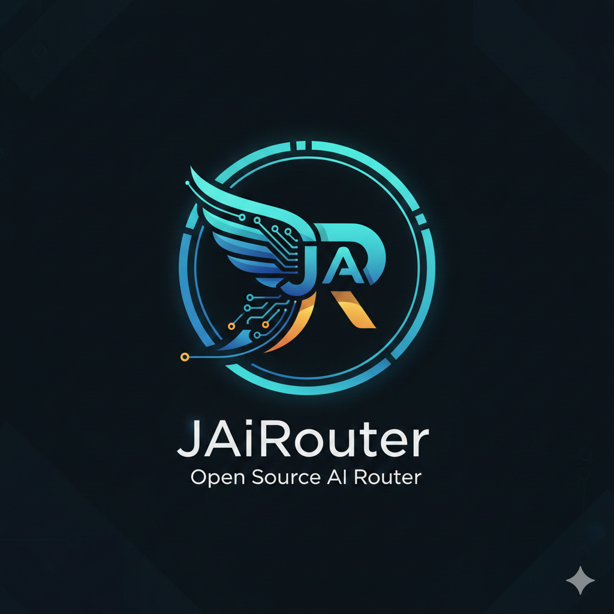
</p>

<p align="center">
  <strong>把你在跑的所有模型后端收进一个 OpenAI 兼容端点。</strong>
</p>

<p align="center">
  Ollama · vLLM · GPUStack · Xinference · LocalAI · OpenAI · Claude · Gemini<br>
  路由 · 负载均衡 · 限流 · 熔断 · 失败转移 · RBAC · 审计 · 可视化控制台
</p>

<p align="center">
  <em>Java + Spring Boot —— 写给栈里已经有 JVM 的团队。</em>
</p>

<p align="center">
  <a href="https://github.com/Lincoln-cn/JAiRouter/releases">
    
  </a>
  <a href="https://hub.docker.com/r/sodlinken/jairouter">
    
  </a>
  <a href="https://github.com/Lincoln-cn/JAiRouter/blob/master/LICENSE">
    
  </a>
</p>

<p align="center">
  <a href="README.md">English</a> •
  <a href="https://jairouter.com">文档站</a> •
  <a href="https://github.com/Lincoln-cn/JAiRouter/issues">Issues</a> •
  <a href="https://github.com/Lincoln-cn/JAiRouter/discussions">Discussions</a>
</p>

本 README 同时面向**人和 AI 助手**编写：下方的事实块，以及[仓库地图](#仓库地图)、
[常用命令](#常用命令)、[HTTP 面](#http-面)三节，是可直接机器读取的核心。**代码与本文件冲突时以代码为准**，
并请开 issue 提醒我们修文档。

<!-- 事实块：请与 pom.xml、application*.yml 及各 workflow 保持同步 -->
```yaml
product:         JAiRouter
repository:      Lincoln-cn/JAiRouter
checkout_dir:    model-router            # 本地/仓库目录名与产品名不同
artifact:        model-router            # Maven artifactId
project_version: 3.8.8                   # pom.xml
latest_release:  v3.8.8 (2026-11-16)
stack:
  backend:  Java 17 + Spring Boot 4.1.2（WebFlux / 响应式）
  frontend: Vue 3 + TypeScript + Vite，中英双语（zh-CN / en-US）
  build:    Maven wrapper —— ./mvnw（Unix）· .\mvnw.cmd（Windows）
runtime:
  default_port: 8080
  console:      /admin/
  swagger_ui:   仅 dev profile
  required_env_in_prod: [JWT_SECRET, INITIAL_ADMIN_PASSWORD]
  required_env_in_staging: [JWT_SECRET]
surfaces:
  - /v1/**        # 客户端面：OpenAI 原生 + Anthropic 兼容
  - /api/**       # 管理面 + 历史面（受 RBAC 治理）
  - /actuator/**  # 健康、就绪、Prometheus
tests:
  command: ./mvnw test -o
  scale:   约 600 个测试类、约 5,100 个测试方法
license: Apache-2.0
```

## 为什么是这个

多数 LLM 网关要么是 Python 的（LiteLLM），要么是一整套你得整体接管的网关栈（Kong、APISIX、Envoy）。
如果你的服务本来就在 Spring Boot 上、运维也已经有 JVM 的容器化经验，那 JAiRouter 是同一件事
换一个你本来就会部署、会监控、会排查的栈：一个 jar 或一个镜像，PostgreSQL 或 H2，Flyway 迁移，
Micrometer 与 Prometheus，外加一个读起来像管理后台的控制台。

它不打算做万能代理。它要做一个**中小规模部署里真正能运维**的网关：授权细到权限码，
审计经得起事后翻阅，配置改了不用重启。

## 它是什么

JAiRouter 是一个**可自托管的 AI 模型网关**。它把你已有的模型服务——Ollama、vLLM、GPUStack、
Xinference、LocalAI——以及云端供应商（OpenAI、Anthropic、Gemini，以及任何 OpenAI 兼容厂商）
统一到一个 OpenAI 兼容端点之后。原有的 OpenAI SDK、LangChain、LlamaIndex 代码无需改动：把
`base_url` 指过来即可。

它补齐的是你本来要自己写的那一层：多实例负载均衡、限流、实例熔断与**换一个健康实例重试**的
失败转移、RBAC、审计日志、记录治理与可观测性——全部可以从 Web 控制台在运行时修改，无需重启进程。

| 问题 | JAiRouter 的做法 |
|------|------------------|
| 模型端点太多、分散管理 | 统一到一个 API 面 |
| 后端挂了要人工切换 | 熔断 + 请求级失败转移 |
| 每个服务各自实现鉴权 | 内置 JWT + API Key，配数据驱动 RBAC |
| 日志和指标散落在各后端 | 统一指标、链路追踪、调用历史 |
| 改配置要重启 | 控制台热重载 |

## 快速开始

### 5 分钟演示 —— 不需要模型服务

两个容器加一个脚本，把网关从头到尾走一遍：请求转发、换模型、响应缓存、可逆脱敏。上游是一个 mock，
所以不用准备 GPU、不用申请 API Key、也不用装 JDK。

```bash
docker compose -f deploy/demo/docker-compose.yml pull        # 拿到 v3.8.1 及之后的镜像
docker compose -f deploy/demo/docker-compose.yml up -d      # 等两个容器都 healthy
node scripts/demo/run-demo.mjs
```

完整说明（含怎么从上游侧确认可逆脱敏生效）：[5 分钟演示](docs/zh/getting-started/demo.md)。

### 开发 profile —— 无需任何密钥

```bash
docker run -d --name jairouter -p 8080:8080 \
  -e SPRING_PROFILES_ACTIVE=dev \
  sodlinken/jairouter:latest

# 控制台：  http://localhost:8080/admin/
# 默认账号: admin / ChangeMeOnFirstStartup123456
```

dev profile 有意回退到内置的开发用密钥，因此零配置即可启动。**切勿把 dev profile 实例暴露在不可信网络。**

### 生产 profile —— 密钥必填

```bash
docker run -d --name jairouter -p 8080:8080 \
  -e JWT_SECRET="$(openssl rand -base64 48)" \
  -e INITIAL_ADMIN_PASSWORD='<你的强管理密码>' \
  sodlinken/jairouter:latest
```

**两个变量都是必填。** `prod` profile 带启动安全门闩：任一缺失、或仍是出厂默认值时
**拒绝启动**——具体规则见[生产环境启动门闩](#生产环境启动门闩)。只给 `JWT_SECRET` 的容器会在启动阶段
以 `IllegalStateException` 退出。

直接跑 JAR（不走 Docker）时，先生成强值：

```bash
java -jar target/model-router-*.jar --generate-key        # JWT 密钥
java -jar target/model-router-*.jar --generate-password   # 管理员密码
```

### 让客户端接进来

```python
from openai import OpenAI

client = OpenAI(
    base_url="http://localhost:8080/v1",             # OpenAI 原生面（原始 JSON / SSE）
    api_key="not-needed",                            # Authorization 会被转发给下游
    default_headers={"X-API-Key": "<your-api-key>"}  # 网关凭据（管理面创建的 API Key）
)

response = client.chat.completions.create(
    model="llama3.2",                                # 你配置过的任意模型
    messages=[{"role": "user", "content": "Hello!"}]
)
print(response.choices[0].message.content)
```

已注册的后端在控制台的**实例管理**里维护；改动经热重载生效，无需重启。

## 生产环境启动门闩

门闩实现位于 `StartupSecretKeyChecker`（一个 `CommandLineRunner`）与 `StartupSecurityGate`。
每次启动都会执行，且**直接读环境变量**——只设置等价的 YAML 属性**不足以**通过它：

| 检查项 | `prod` / `production` profile 下的规则 | 其它 profile |
|--------|----------------------------------------|--------------|
| JWT 是否启用 | `jairouter.security.jwt.enabled` 必须为 `true`，否则失败 | 不检查 |
| `JWT_SECRET` | 必须已设置、不是已知出厂/文档默认值、且强度不低于 `MEDIUM` | 仅告警 |
| `INITIAL_ADMIN_PASSWORD` | 必须已设置、不能是出厂默认值 `ChangeMeOnFirstStartup123456`、且强度不低于 `MEDIUM` | 仅告警 |

几点值得知道：

- **生产环境缺 `INITIAL_ADMIN_PASSWORD` 是硬失败。** 配置绑定只读这个名字——旧的 `ADMIN_PASSWORD`
  别名已移除——且**系统不会替你生成任何密码**。
- **不存在「自动生成随机密码」这回事。** 两个变量都没设时启动直接中止——既不会随机生成，
  也不会回落到文档里的默认值。（唯一的生成器是显式 CLI 参数 `--generate-key` / `--generate-password`。）
- 强度为 `MEDIUM` 的值会打警告并**允许**启动；`VERY_WEAK` / `WEAK` 会阻断启动。
- 可信隔离网络的逃生舱：`JAIRouter_SKIP_AUTH_WARNING=true`。必须显式设置，且它会一次性关掉
  上表**全部**检查。
- `admin` 账号本身来自 `src/main/resources/config/auth/jwt.yml` 的
  `jairouter.security.jwt.accounts`，其口令是
  `{noop}${INITIAL_ADMIN_PASSWORD:ChangeMeOnFirstStartup123456}`。首次启动时这些 YAML 账户会在
  `jwt_accounts` 表**为空**的前提下被写入该表（`JpaDatabaseInitializer.initializeJwtAccounts`）；
  之后的启动不再改动该表，所以**改 `INITIAL_ADMIN_PASSWORD` 不会改变已存在于数据库里的账号**——
  请到控制台里改。

## 仓库地图

| 路径 | 内容 |
|------|------|
| `src/main/java/org/unreal/modelrouter/router/` | 网关核心：适配器、请求处理器、负载均衡、规则引擎、熔断、缓存 |
| `src/main/java/org/unreal/modelrouter/auth/` | 认证（JWT、API Key）、脱敏、安全审计、RBAC、控制台侧认证接口 |
| `src/main/java/org/unreal/modelrouter/monitor/` | 指标、链路追踪、调用历史、慢查询分析、错误追踪、安全告警 |
| `src/main/java/org/unreal/modelrouter/persistence/` | 存储抽象 + JPA 实体与仓储 + schema 初始化 |
| `src/main/java/org/unreal/modelrouter/config/` | 配置服务：热重载、版本与回滚、校验、控制台接口 |
| `src/main/resources/config/**` | 模块化 YAML 配置，由 `application.yml` 的 `spring.config.import` 引入 |
| `src/main/resources/db/migration/{h2,postgres}/` | 版本化 schema 迁移（`Flyway`），两种方言各一个目录 |
| `src/test/java/` | JUnit 5 + Mockito + Reactor `StepVerifier`；约 5,100 个测试方法 |
| `frontend/` | Vue 3 + TypeScript 控制台（Vite `base: /admin/`） |
| `docs/zh/`、`docs/en/` | MkDocs 文档，中英保持对称 |
| `deploy/` | Kubernetes 清单、compose 文件、部署脚本 |
| `.cspell.json` | 拼写检查词表——文档门闩对未知词报错 |
| `innerdoc/` | 内部设计笔记，不对外发布 |

## 常用命令

```bash
# 构建（跳过测试）
./mvnw clean package -DskipTests

# 本地运行
java -jar target/model-router-*.jar --spring.profiles.active=dev

# 全量 Java 测试（离线可跑；加 skip 参数可加快迭代）
./mvnw test -o

# 聚焦测试 —— 类名用逗号分隔，不支持通配符
./mvnw test -Dtest=FooTest,BarTest -DfailIfNoTests=false -o

# 前端（类型检查 + 构建）
cd frontend && npm ci && npm run type-check && npm run build
```

Windows 下把 `./mvnw` 换成 `.\mvnw.cmd`。

## HTTP 面

| 面 | 前缀 | 协议 | 鉴权 |
|----|------|------|------|
| 客户端 —— OpenAI 原生 | `/v1/**` | OpenAI JSON + SSE（`/v1/chat/completions`、`/v1/models`、`/v1/embeddings`、`/v1/rerank`） | JWT 或 API Key |
| 客户端 —— Anthropic 兼容 | `/v1/messages`、`/v1/messages/count_tokens` | Anthropic Messages（流式 SSE、工具调用） | JWT 或 API Key |
| 管理面 | `/api/**` | JSON，`RouterResponse` 信封 | JWT/API Key + RBAC URL 矩阵 |
| 运维面 | `/actuator/**` | 健康、就绪、`/actuator/prometheus` | 视 profile |

错误体按面区分协议形状：`/v1/messages` 上为 Anthropic 形状的
`{"type":"error","error":{...}}`，其余 `/v1/**` 路径为 OpenAI 形状的
`{"error":{message,type,code}}`，`/api/**` 保持历史形状。`/v1` 面的流式失败会发出协议形状的
error 帧，**并且仍以异常终止流**——失败流绝不补 `[DONE]`，因为客户端把 `[DONE]` 视为成功。

## 认证与授权

- **JWT** —— 头名可配置，默认 `Jairouter_Token`。
- **API Key** —— 头 `X-API-Key`。网关凭据与下游供应商密钥彻底分离：`x-api-key` 只被网关消费、
  绝不透传，实例级下游凭据请放在该实例自己的 `headers.Authorization`。
- **RBAC** —— 数据驱动：74 个权限码、6 个角色模板（`ADMIN` / `OPERATOR` / `USER` / `VIEWER`）、
  URL 规则矩阵 + 方法级 `@PreAuthorize`。未命中任何规则的请求按
  `jairouter.security.rbac.unmatched-policy` 处理，默认 `DENY_ALL`；`ROLE_ADMIN` 恒直通。
  `/v1/**` 需要认证，但有意不进权限矩阵。

## 能力清单

已实现、且有测试套件覆盖：

- **适配器** —— Ollama、vLLM、GPUStack、Xinference、LocalAI、OpenAI、Anthropic（原生）、
  Gemini（原生），以及在 `adapter-definitions` 里声明的任意 OpenAI 兼容厂商。
- **负载均衡** —— 轮询、加权、最少连接、IP 哈希、一致性哈希、EWMA 延迟感知、随机。
- **规则引擎** —— 按模型、服务类型、请求头、客户端 IP、权重、实例标签做条件路由，带命中统计；
  控制台可视化编辑。
- **韧性** —— 实例级熔断、请求级失败转移到另一健康实例、限流（令牌桶 / 漏桶 / 滑动窗口）、
  确定性请求的响应缓存（可选开启，按租户隔离键）。
- **配额** —— 多维度、多窗口账本（`MINUTE`/`HOUR`/`DAY`/`MONTH`），Redis 分布式计数并本地降级
  （`jairouter.quota.enabled`，默认关闭）。
- **记录治理** —— 调用历史三档：仅元数据 / 脱敏摘要 / AES-256-GCM 加密全文；解密端点仅 ADMIN。
- **可观测性** —— Prometheus 指标、OpenTelemetry 链路追踪、慢查询分析、错误追踪、安全告警。
  告警出口被有意限定为 **Prometheus 指标 + 结构化日志**——仓内不实现任何推送通道
  （邮件/Webhook/IM），请在 Alertmanager 或日志平台里接。
- **持久化** —— 默认 H2；当 `DATABASE_URL` 指向 PostgreSQL 时用 PostgreSQL（配 `Flyway` 迁移）；
  多副本部署用 Redis 承载共享状态。
- **多副本** —— 跨副本事件广播、共享限流/配额计数、定时任务的分布式锁（含告警冷却）。
- **控制台** —— `/admin/` 的 Vue 3 界面：服务、实例、适配器、规则、版本与回滚、配额、调用历史、
  链路追踪、告警、API Key、RBAC，深/浅主题，中英双语。

未实现：仓内通知推送。**语义缓存**（用 SimHash 近似复用非流式响应）已提供但默认关闭，见 `jairouter.semantic-cache.enabled`。
逐版本说明见[更新日志](docs/zh/reference/changelog.md)。

## 架构

<details>
<summary><b>请求流</b></summary>

```
┌─────────────────────────────────────────────────────────────────┐
│                         Your Application                         │
│                 (OpenAI SDK / LangChain / LlamaIndex)           │
└─────────────────────────────────┬───────────────────────────────┘
                                  │
                                  ▼ OpenAI-Compatible API
┌─────────────────────────────────────────────────────────────────┐
│                         JAiRouter Gateway                        │
│  ┌─────────┐ ┌─────────┐ ┌─────────┐ ┌─────────┐ ┌─────────┐   │
│  │ Routing │ │ Balance │ │  Limit  │ │ Circuit │ │   Auth  │   │
│  └─────────┘ └─────────┘ └─────────┘ └─────────┘ └─────────┘   │
│  ┌─────────────────────────────────────────────────────────┐   │
│  │              Observability & Persistence                 │   │
│  └─────────────────────────────────────────────────────────┘   │
└─────────────────────────────────┬───────────────────────────────┘
                                  │
       ┌──────────────┬───────────┼───────────┬──────────────┐
       ▼              ▼           ▼           ▼              ▼
   ┌───────┐     ┌───────┐   ┌───────┐   ┌──────────┐   ┌───────┐
   │Ollama │     │ vLLM  │   │GPUStack│  │Xinference│   │ OpenAI │
   └───────┘     └───────┘   └───────┘   └──────────┘   └───────┘
```

</details>

## 控制台导览

控制台是一个 Vue 3 单页应用，由同一个 Spring Boot jar 在 `/admin/` 提供 —— 不用单独部署前端容器，也不额外占端口。界面双语（zh-CN / en-US），自带亮色与暗色主题。下面的截图都取自运行中的实例（演示数据），因此需要流量累积的面板显示的是空态，而不是专门摆拍的界面。

### 指挥中心 —— 一屏回答「哪里坏了」

<p align="center">
  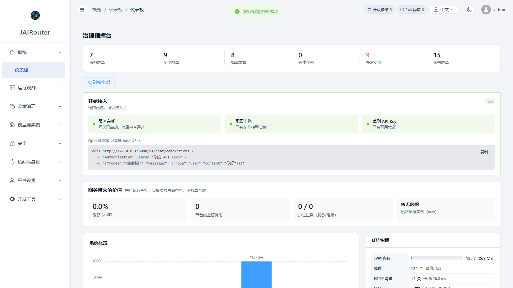
</p>

顶部那一行是这套部署的清单：服务、实例、模型、健康实例数、不健康实例数、账号数。下面是与「要不要重启」直接相关的系统指标 —— JVM 内存、线程数、CPU 负载、运行时长、认证成功与失败、审计事件 —— 以及一条**治理链**，报告每个请求都要经过的四个环节各自的状态：规则命中、限流、断路器、负载均衡。客户端报错时，先在这里判断是哪一环出的问题。

### 服务管理 —— 服务类型、适配器与策略

<p align="center">
  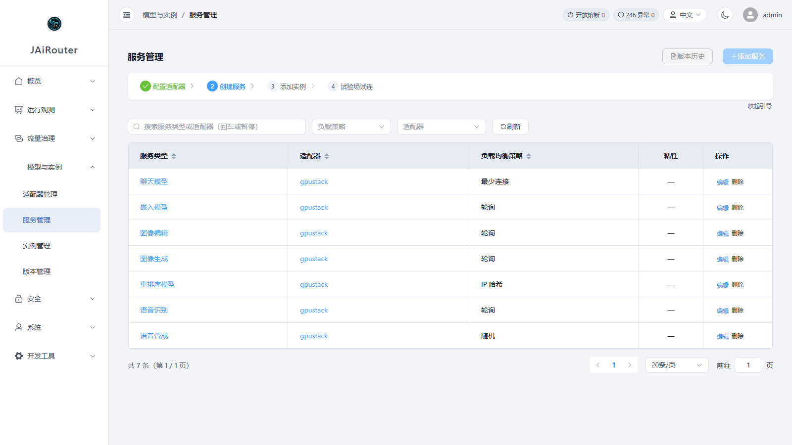
</p>

一个服务就是（服务类型、适配器、负载均衡策略）三元组。列表里是网关能提供的七种服务类型 —— 对话、向量化、重排、语音转文字、文字转语音、图像生成、图像编辑 —— 各自绑定一个适配器（GPUStack、vLLM、Ollama、OpenAI……）和一套策略，从轮询到最少连接、IP 哈希。页面顶部的四步引导就是接一个新后端该走的顺序：配置适配器 → 创建服务 → 添加实例 → 去演练场试一次。适配器配错了会在第一步就暴露，而不是等第一个真实请求打进来。

### 实例管理 —— 服务背后的真实端点

<p align="center">
  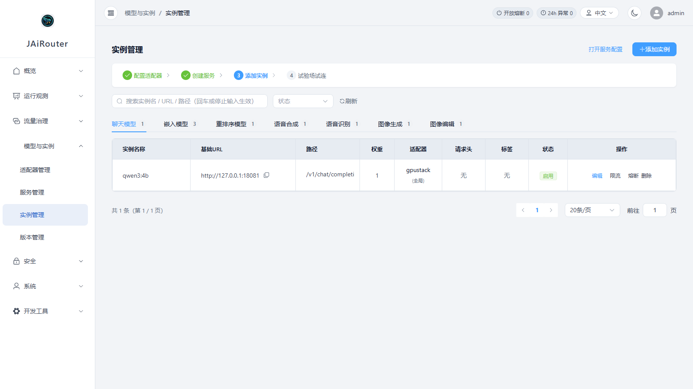
</p>

一个实例就是一个真实端点：Base URL、路径、权重、单实例请求头与标签，按服务类型分页签。权重供加权类策略使用，标签供规则条件使用，单实例请求头则是让下游凭据只留在那一个上游的写法。每一行都自带限流与断路器，某个上游出问题时可以只隔离它、只修它，不用动整个服务。

### 路由规则 —— 条件、优先级与目标

<p align="center">
  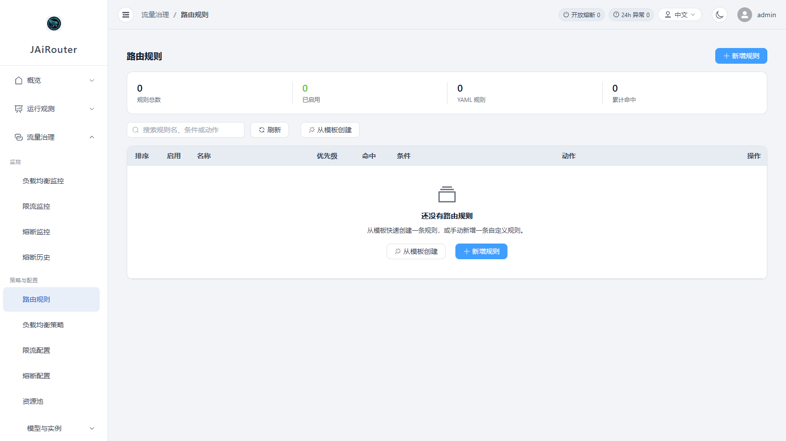
</p>

规则在任何负载均衡决策之前生效。上图这条规则把请求头 `x-tenant` 等于 `tenant-a` 的请求以优先级 90 固定到 `internal-gpu-1`。规则可以拖拽排序，可以停用而不必删除，命中计数是实时更新的 —— 所以一条从不命中的规则是看得见的，不会悄悄变成死配置。常用形态（租户固定、灰度分流、按请求头 A/B）有模板可直接套。

### 调用历史分析 —— 三档记录，一个看板

<p align="center">
  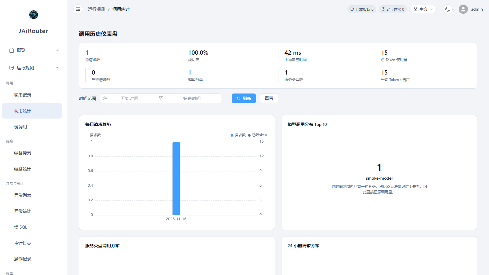
</p>

每一次调用都按三档之一记录 —— 仅元数据、脱敏摘要、AES-256-GCM 加密全文 —— 这个页面把记录收敛成运维真正要看的数：总请求与失败请求、成功率、平均响应时间、Token 消耗与单请求均值，再往下是每日趋势、Top 10 模型、服务类型构成和 24 小时分布。顶部的时间范围会一次性筛掉所有面板，原始记录就在旁边的页签里。

### 慢查询分析 —— 延迟到底花在哪

<p align="center">
  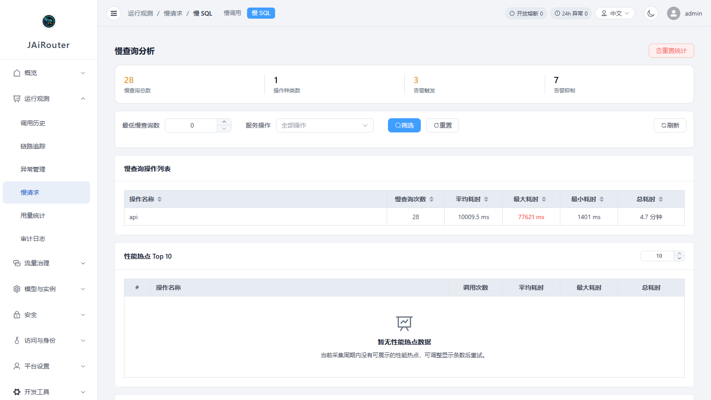
</p>

慢查询会被计数、按操作归类，并给出每组的次数、平均、最大、最小与总耗时，另有一张热点表指向最差的那几个。右侧两个数字容易读错：告警**触发**次数与告警**抑制**次数。抑制走的是冷却逻辑 —— 同一个热点持续越过阈值只记一次，之后安静下来，所以「抑制多、触发少」是设计在正常工作，而不是阈值坏了。

### AI 演练场 —— 接客户端之前先验模型

<p align="center">
  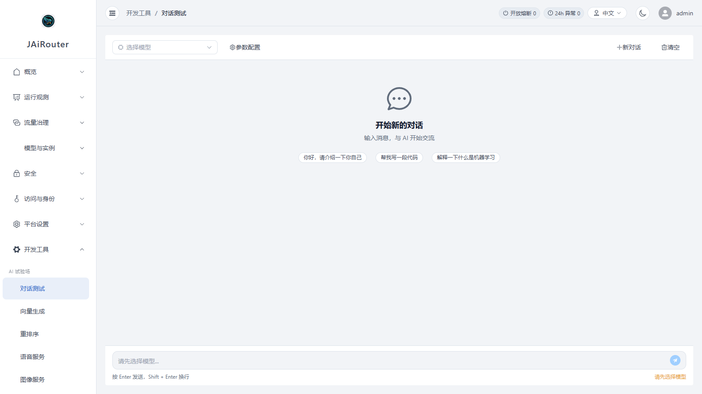
</p>

一个模型选择器后面挂了五个测试台：对话、向量化、重排、语音服务与图像服务。验证一个新加入的实例能不能正确应答，这是最快的路径 —— 凭据、路由与记录治理都和真实客户端一致，但请求和流式响应都直接显示在页面上。没选模型之前发送是禁用的，不会出现「点了没反应」。

### 配额运行时配置 —— 哪些立即生效，哪些要重启

<p align="center">
  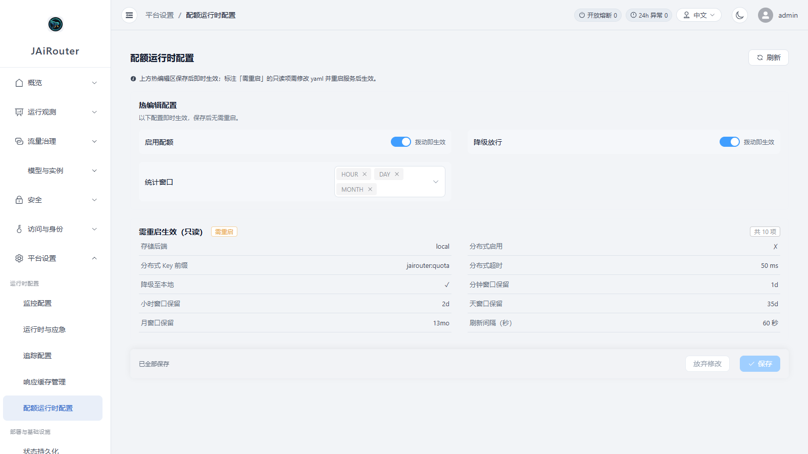
</p>

配额设置按「生效代价」分成两类。**可热改**的 —— 启用配额、失败放行（Fail Open）、统计窗口（分钟 / 小时 / 天 / 月）—— 保存即生效。**需重启**的字段是只读的、带角标说明，而不是让人改完才发现没生效。页面顶部的状态条会把当前实际状态摊开：启用还是关闭、存储后端（本地或 Redis）、是否失败放行、刷写间隔。配额默认关闭，这里就是打开它的地方。

### 配额用量监控 —— 多维筛选，且如实说明自身状态

<p align="center">
  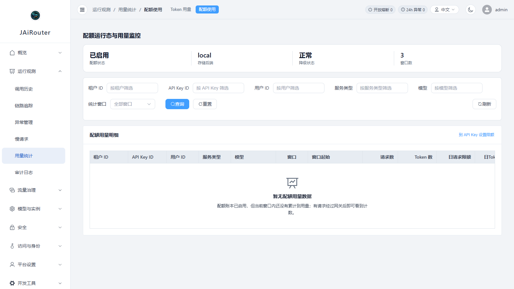
</p>

用量可以同时按六个维度筛 —— 租户、API Key、用户、服务类型、模型、窗口 —— 按租户对账或按 Key 复盘事故都不必先导出数据。上方四张状态卡先回答真正该问的问题（账本是否启用、用的是哪个后端、是否降级、有几个活跃窗口），再展示数字；没有数据时它直接说明原因（配额账本未启用），而不是渲染一张空表让人猜。

### 客户端接入指引 —— 一页带一个团队上手

<p align="center">
  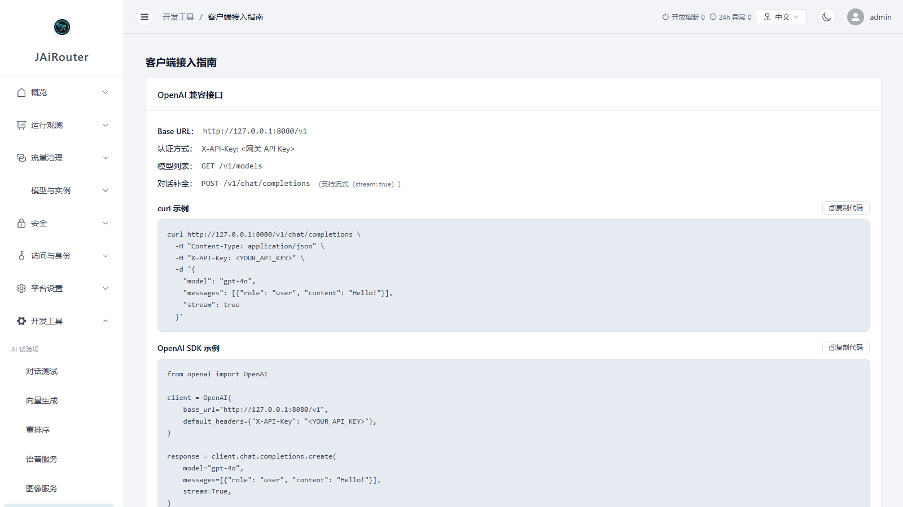
</p>

新团队应该第一个打开的页面：Base URL、`X-API-Key` 请求头、`GET /v1/models`、`POST /v1/chat/completions` 及其流式写法，然后是同一段调用的 `curl` 版本与 OpenAI Python SDK 版本，每个块都有复制按钮。Base URL 取自这个实例自己的配置，所以复制到的就是这台网关实际对外提供的地址。

### 暗色主题

<p align="center">
  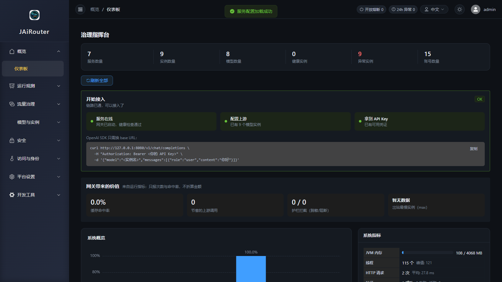
</p>

同一个控制台，内置暗色主题 —— 顶栏一个开关，不需要另起构建，也不用加查询参数。zh-CN / en-US 切换就在它旁边。

## 状态

**最新版本：v3.8.8（2026-11-16）。** 逐版本说明、升级提示与已知边界见[更新日志](docs/zh/reference/changelog.md)；
下载与容器 tag 见 [Releases](https://github.com/Lincoln-cn/JAiRouter/releases)。

本文件不重复发版历史。此前复制过一份，结果落后了 changelog 五个版本 —— 只有一个事实来源才不会失真。


## 文档

| 资源 | 链接 |
|------|------|
| 完整文档 | https://jairouter.com |
| 部署 | https://jairouter.com/deployment/ |
| 配置 | https://jairouter.com/configuration/ |
| 监控 | https://jairouter.com/monitoring/ |
| 交互式 API 文档 | `http://localhost:8080/swagger-ui`（dev profile） |

## 为什么选 JAiRouter？

- **对比直连后端** —— 没有共享的韧性、没有中心化凭据、没有用量可见性。JAiRouter 给你一个端点、
  自动失败转移与完整审计轨迹。
- **对比 One-API / new-api** —— 它们面向共享账号的分发与计费。JAiRouter 是**你自己**推理集群前面的
  那层网关：多实例均衡、熔断、规则路由、自托管 Ollama/vLLM/GPUStack 的 RBAC 与可观测性。两者互补。
- **对比 Nginx** —— Nginx 是通用 Web 服务器；JAiRouter 为模型负载而建：OpenAI 兼容路由、
  模型感知均衡、流式语义。
- **对比 LangChain** —— LangChain 是应用框架；JAiRouter 是它下面的基础设施层。

| 能力 | JAiRouter | Nginx | One-API | LangChain |
|------|:---------:|:-----:|:-------:|:---------:|
| OpenAI 兼容 | ✅ | ❌ | ✅ | ✅ |
| 负载均衡 | ✅ | ✅ | ✅ | ❌ |
| 熔断 | ✅ | ❌ | ❌ | ❌ |
| 限流 | ✅ | ✅ | ✅ | ❌ |
| Web 控制台 | ✅ | ❌ | ✅ | ❌ |
| 配置热重载 | ✅ | ❌ | ✅ | ❌ |
| 版本管理 | ✅ | ❌ | ❌ | ❌ |
| OpenTelemetry | ✅ | ❌ | ❌ | ✅ |

## 参与贡献

欢迎贡献——见[贡献指南](https://jairouter.com/development/contributing/)。

安全问题请不要开公开 issue，按 [SECURITY.md](SECURITY.md) 私下报告。

提 PR 前请先跑：

```bash
./mvnw test -o                       # 约 600 个测试类、约 5,100 个测试方法，必须保持全绿
cd frontend && npm run type-check    # 前端类型门闩
```

几条仓内约定：提交信息用 `<type>(<scope>): <summary>`；每个修复/功能分支都指向 `master` 并以
squash 方式合并；文档同时存在于 `docs/zh/` 与 `docs/en/` 且要求保持对称；文档会按 `.cspell.json`
做拼写检查，新技术名词可能需要先加进词表。

```bash
git clone https://github.com/Lincoln-cn/JAiRouter.git
cd JAiRouter
./mvnw clean package -DskipTests
java -jar target/model-router-*.jar
```

## 支持

- **文档**：https://jairouter.com

### 该发 Issue 还是 Discussion？

GitHub 给了我们两个渠道，我们有意分开，避免信息丢失。按**你手上有什么**来选：

| 你有什么 | 发到哪里 | 我们怎么处理 |
|----------|----------|--------------|
| **可复现的缺陷** —— 崩溃、结果错误、回归、文档写错 | [**Issues**](https://github.com/Lincoln-cn/JAiRouter/issues) | 快速分诊；确认的缺陷会被修复或排期 |
| **需求或想法** —— 功能请求、新适配器、设计讨论、使用提问 | [**Discussions**](https://github.com/Lincoln-cn/JAiRouter/discussions) | 定期梳理，收集与投票后并入路线图 |

**一句话**：缺陷发 **Issues**；需求或提问发 **Discussions**。

> 拿不准？先发 Discussions——如果最后确认是可复现的缺陷，我们会帮你转到 Issues。

Discussions 按分类组织：

| 分类 | 用途 |
|------|------|
| 💡 Ideas | 功能请求与改进建议 |
| 🗳 Polls | 社区对方向的投票 |
| 🙏 Q&A | 使用问题互助 |
| 🙌 Show and tell | 分享你基于 JAiRouter 做的东西 |
| 💬 General | 其它 |
| 📣 Announcements | 维护者的发布说明 |

## 许可

JAiRouter 基于 [Apache 2.0 许可](LICENSE) 发布。

---

<p align="center">
  <strong>如果 JAiRouter 帮你省了时间，<a href="https://github.com/Lincoln-cn/JAiRouter/stargazers">在 GitHub 上点个 Star</a> ⭐</strong>
  <br/>
  <em>发现 bug？开 issue。有想法或疑问？开 discussion。</em>
</p>

<p align="center">
  Maintained by Lincoln-cn · Apache-2.0
</p>
