# JAiRouter

<p align="center">
  
</p>

<p align="center">
  <strong>把你在跑的所有模型后端收进一个 OpenAI 兼容端点。</strong>
</p>

<p align="center">
  Ollama · vLLM · GPUStack · Xinference · LocalAI · OpenAI · Claude · Gemini<br>
  路由 · 负载均衡 · 限流 · 熔断 · 失败转移 · RBAC · 审计 · 可视化控制台
</p>

<p align="center">
  <a href="https://github.com/Lincoln-cn/JAiRouter/releases">
    
  </a>
  <a href="https://hub.docker.com/r/sodlinken/jairouter">
    
  </a>
  <a href="https://github.com/Lincoln-cn/JAiRouter/blob/master/LICENSE">
    
  </a>
</p>

<p align="center">
  <a href="README.md">English</a> •
  <a href="https://jairouter.com">文档站</a> •
  <a href="https://github.com/Lincoln-cn/JAiRouter/issues">Issues</a> •
  <a href="https://github.com/Lincoln-cn/JAiRouter/discussions">Discussions</a>
</p>

本 README 同时面向**人和 AI 助手**编写：下方的事实块，以及[仓库地图](#仓库地图)、
[常用命令](#常用命令)、[HTTP 面](#http-面)三节，是可直接机器读取的核心。**代码与本文件冲突时以代码为准**，
并请开 issue 提醒我们修文档。

<!-- 事实块：请与 pom.xml、application*.yml 及各 workflow 保持同步 -->
```yaml
product:         JAiRouter
repository:      Lincoln-cn/JAiRouter
checkout_dir:    model-router            # 本地/仓库目录名与产品名不同
artifact:        model-router            # Maven artifactId
project_version: 3.3.0                   # pom.xml
latest_release:  v3.3.0 (2026-10-07)
stack:
  backend:  Java 17 + Spring Boot 3.5.5（WebFlux / 响应式）
  frontend: Vue 3 + TypeScript + Vite，中英双语（zh-CN / en-US）
  build:    Maven wrapper —— ./mvnw（Unix）· .\mvnw.cmd（Windows）
runtime:
  default_port: 8080
  console:      /admin/
  swagger_ui:   仅 dev profile
  required_env_in_prod: [JWT_SECRET, INITIAL_ADMIN_PASSWORD]
surfaces:
  - /v1/**        # 客户端面：OpenAI 原生 + Anthropic 兼容
  - /api/**       # 管理面 + 历史面（受 RBAC 治理）
  - /actuator/**  # 健康、就绪、Prometheus
tests:
  command: ./mvnw test -o
  scale:   388 个测试类，约 4000 个测试方法
license: Apache-2.0
```

## 它是什么

JAiRouter 是一个**可自托管的 AI 模型网关**。它把你已有的模型服务——Ollama、vLLM、GPUStack、
Xinference、LocalAI——以及云端供应商（OpenAI、Anthropic、Gemini，以及任何 OpenAI 兼容厂商）
统一到一个 OpenAI 兼容端点之后。原有的 OpenAI SDK、LangChain、LlamaIndex 代码无需改动：把
`base_url` 指过来即可。

它补齐的是你本来要自己写的那一层：多实例负载均衡、限流、实例熔断与**换一个健康实例重试**的
失败转移、RBAC、审计日志、记录治理与可观测性——全部可以从 Web 控制台在运行时修改，无需重启进程。

| 问题 | JAiRouter 的做法 |
|------|------------------|
| 模型端点太多、分散管理 | 统一到一个 API 面 |
| 后端挂了要人工切换 | 熔断 + 请求级失败转移 |
| 每个服务各自实现鉴权 | 内置 JWT + API Key，配数据驱动 RBAC |
| 日志和指标散落在各后端 | 统一指标、链路追踪、调用历史 |
| 改配置要重启 | 控制台热重载 |

## 快速开始

### 开发 profile —— 无需任何密钥

```bash
docker run -d --name jairouter -p 8080:8080 \
  -e SPRING_PROFILES_ACTIVE=dev \
  sodlinken/jairouter:latest

# 控制台：  http://localhost:8080/admin/
# 默认账号: admin / ChangeMeOnFirstStartup123456
```

dev profile 有意回退到内置的开发用密钥，因此零配置即可启动。**切勿把 dev profile 实例暴露在不可信网络。**

### 生产 profile —— 密钥必填

```bash
docker run -d --name jairouter -p 8080:8080 \
  -e JWT_SECRET="$(openssl rand -base64 48)" \
  -e INITIAL_ADMIN_PASSWORD='<你的强管理密码>' \
  sodlinken/jairouter:latest
```

**两个变量都是必填。** `prod` profile 带启动安全门闩：任一缺失、或仍是出厂默认值时
**拒绝启动**——具体规则见[生产环境启动门闩](#生产环境启动门闩)。只给 `JWT_SECRET` 的容器会在启动阶段
以 `IllegalStateException` 退出。

直接跑 JAR（不走 Docker）时，先生成强值：

```bash
java -jar target/model-router-*.jar --generate-key        # JWT 密钥
java -jar target/model-router-*.jar --generate-password   # 管理员密码
```

### 让客户端接进来

```python
from openai import OpenAI

client = OpenAI(
    base_url="http://localhost:8080/v1",             # OpenAI 原生面（原始 JSON / SSE）
    api_key="not-needed",                            # Authorization 会被转发给下游
    default_headers={"X-API-Key": "<your-api-key>"}  # 网关凭据（管理面创建的 API Key）
)

response = client.chat.completions.create(
    model="llama3.2",                                # 你配置过的任意模型
    messages=[{"role": "user", "content": "Hello!"}]
)
print(response.choices[0].message.content)
```

已注册的后端在控制台的**实例管理**里维护；改动经热重载生效，无需重启。

## 生产环境启动门闩

门闩实现位于 `StartupSecretKeyChecker`（一个 `CommandLineRunner`）与 `StartupSecurityGate`。
每次启动都会执行，且**直接读环境变量**——只设置等价的 YAML 属性**不足以**通过它：

| 检查项 | `prod` / `production` profile 下的规则 | 其它 profile |
|--------|----------------------------------------|--------------|
| JWT 是否启用 | `jairouter.security.jwt.enabled` 必须为 `true`，否则失败 | 不检查 |
| `JWT_SECRET` | 必须已设置、不是已知出厂/文档默认值、且强度不低于 `MEDIUM` | 仅告警 |
| `INITIAL_ADMIN_PASSWORD` | 必须已设置、不能是出厂默认值 `ChangeMeOnFirstStartup123456`、且强度不低于 `MEDIUM` | 仅告警 |

几点值得知道：

- **生产环境缺 `INITIAL_ADMIN_PASSWORD` 是硬失败。** `ADMIN_PASSWORD` 作为备用变量名被接受，
  但**系统不会替你生成任何密码**。
- **不存在「自动生成随机密码」这回事。** 两个变量都没设时启动直接中止——既不会随机生成，
  也不会回落到文档里的默认值。（唯一的生成器是显式 CLI 参数 `--generate-key` / `--generate-password`。）
- 强度为 `MEDIUM` 的值会打警告并**允许**启动；`VERY_WEAK` / `WEAK` 会阻断启动。
- 可信隔离网络的逃生舱：`JAIRouter_SKIP_AUTH_WARNING=true`。必须显式设置，且它会一次性关掉
  上表**全部**检查。
- `admin` 账号本身来自 `src/main/resources/config/auth/jwt.yml` 的
  `jairouter.security.jwt.accounts`，其口令是
  `{noop}${INITIAL_ADMIN_PASSWORD:ChangeMeOnFirstStartup123456}`。首次启动时这些 YAML 账户会在
  `jwt_accounts` 表**为空**的前提下被写入该表（`JpaDatabaseInitializer.initializeJwtAccounts`）；
  之后的启动不再改动该表，所以**改 `INITIAL_ADMIN_PASSWORD` 不会改变已存在于数据库里的账号**——
  请到控制台里改。

## 仓库地图

| 路径 | 内容 |
|------|------|
| `src/main/java/org/unreal/modelrouter/router/` | 网关核心：适配器、请求处理器、负载均衡、规则引擎、熔断、缓存 |
| `src/main/java/org/unreal/modelrouter/auth/` | 认证（JWT、API Key）、脱敏、安全审计、RBAC、控制台侧认证接口 |
| `src/main/java/org/unreal/modelrouter/monitor/` | 指标、链路追踪、调用历史、慢查询分析、错误追踪、安全告警 |
| `src/main/java/org/unreal/modelrouter/persistence/` | 存储抽象 + JPA 实体与仓储 + schema 初始化 |
| `src/main/java/org/unreal/modelrouter/config/` | 配置服务：热重载、版本与回滚、校验、控制台接口 |
| `src/main/resources/config/**` | 模块化 YAML 配置，由 `application.yml` 的 `spring.config.import` 引入 |
| `src/main/resources/db/migration/{h2,postgres}/` | 版本化 schema 迁移（`Flyway`），两种方言各一个目录 |
| `src/test/java/` | JUnit 5 + Mockito + Reactor `StepVerifier`；约 4000 个测试方法 |
| `frontend/` | Vue 3 + TypeScript 控制台（Vite `base: /admin/`） |
| `docs/zh/`、`docs/en/` | MkDocs 文档，中英保持对称 |
| `deploy/` | Kubernetes 清单、compose 文件、部署脚本 |
| `.cspell.json` | 拼写检查词表——文档门闩对未知词报错 |
| `innerdoc/` | 内部设计笔记，不对外发布 |

## 常用命令

```bash
# 构建（跳过测试）
./mvnw clean package -DskipTests

# 本地运行
java -jar target/model-router-*.jar --spring.profiles.active=dev

# 全量 Java 测试（离线可跑；加 skip 参数可加快迭代）
./mvnw test -o

# 聚焦测试 —— 类名用逗号分隔，不支持通配符
./mvnw test -Dtest=FooTest,BarTest -DfailIfNoTests=false -o

# 前端（类型检查 + 构建）
cd frontend && npm ci && npm run type-check && npm run build
```

Windows 下把 `./mvnw` 换成 `.\mvnw.cmd`。

## HTTP 面

| 面 | 前缀 | 协议 | 鉴权 |
|----|------|------|------|
| 客户端 —— OpenAI 原生 | `/v1/**` | OpenAI JSON + SSE（`/v1/chat/completions`、`/v1/models`、`/v1/embeddings`、`/v1/rerank`） | JWT 或 API Key |
| 客户端 —— Anthropic 兼容 | `/v1/messages`、`/v1/messages/count_tokens` | Anthropic Messages（流式 SSE、工具调用） | JWT 或 API Key |
| 管理面 | `/api/**` | JSON，`RouterResponse` 信封 | JWT/API Key + RBAC URL 矩阵 |
| 运维面 | `/actuator/**` | 健康、就绪、`/actuator/prometheus` | 视 profile |

错误体按面区分协议形状：`/v1/messages` 上为 Anthropic 形状的
`{"type":"error","error":{...}}`，其余 `/v1/**` 路径为 OpenAI 形状的
`{"error":{message,type,code}}`，`/api/**` 保持历史形状。`/v1` 面的流式失败会发出协议形状的
error 帧，**并且仍以异常终止流**——失败流绝不补 `[DONE]`，因为客户端把 `[DONE]` 视为成功。

## 认证与授权

- **JWT** —— 头名可配置，默认 `Jairouter_Token`。
- **API Key** —— 头 `X-API-Key`。网关凭据与下游供应商密钥彻底分离：`x-api-key` 只被网关消费、
  绝不透传，实例级下游凭据请放在该实例自己的 `headers.Authorization`。
- **RBAC** —— 数据驱动：53 个权限码、4 个角色模板（`ADMIN` / `OPERATOR` / `USER` / `VIEWER`）、
  URL 规则矩阵 + 方法级 `@PreAuthorize`。未命中任何规则的请求按
  `jairouter.security.rbac.unmatched-policy` 处理，默认 `DENY_ALL`；`ROLE_ADMIN` 恒直通。
  `/v1/**` 需要认证，但有意不进权限矩阵。

## 能力清单

已实现、且有测试套件覆盖：

- **适配器** —— Ollama、vLLM、GPUStack、Xinference、LocalAI、OpenAI、Anthropic（原生）、
  Gemini（原生），以及在 `adapter-definitions` 里声明的任意 OpenAI 兼容厂商。
- **负载均衡** —— 轮询、加权、最少连接、IP 哈希、一致性哈希、EWMA 延迟感知、随机。
- **规则引擎** —— 按模型、服务类型、请求头、客户端 IP、权重、实例标签做条件路由，带命中统计；
  控制台可视化编辑。
- **韧性** —— 实例级熔断、请求级失败转移到另一健康实例、限流（令牌桶 / 漏桶 / 滑动窗口）、
  确定性请求的响应缓存（可选开启，按租户隔离键）。
- **配额** —— 多维度、多窗口账本（`MINUTE`/`HOUR`/`DAY`/`MONTH`），Redis 分布式计数并本地降级
  （`jairouter.quota.enabled`，默认关闭）。
- **记录治理** —— 调用历史三档：仅元数据 / 脱敏摘要 / AES-256-GCM 加密全文；解密端点仅 ADMIN。
- **可观测性** —— Prometheus 指标、OpenTelemetry 链路追踪、慢查询分析、错误追踪、安全告警。
  告警出口被有意限定为 **Prometheus 指标 + 结构化日志**——仓内不实现任何推送通道
  （邮件/Webhook/IM），请在 Alertmanager 或日志平台里接。
- **持久化** —— 默认 H2；当 `DATABASE_URL` 指向 PostgreSQL 时用 PostgreSQL（配 `Flyway` 迁移）；
  多副本部署用 Redis 承载共享状态。
- **多副本** —— 跨副本事件广播、共享限流/配额计数、定时任务的分布式锁（含告警冷却）。
- **控制台** —— `/admin/` 的 Vue 3 界面：服务、实例、适配器、规则、版本与回滚、配额、调用历史、
  链路追踪、告警、API Key、RBAC，深/浅主题，中英双语。

有意**未**实现：语义（向量相似度）缓存，以及任何仓内通知推送。开放中的问题见
[状态与近期工作](#状态与近期工作)。

## 架构

<details>
<summary><b>请求流</b></summary>

```
┌─────────────────────────────────────────────────────────────────┐
│                         Your Application                         │
│                 (OpenAI SDK / LangChain / LlamaIndex)           │
└─────────────────────────────────┬───────────────────────────────┘
                                  │
                                  ▼ OpenAI-Compatible API
┌─────────────────────────────────────────────────────────────────┐
│                         JAiRouter Gateway                        │
│  ┌─────────┐ ┌─────────┐ ┌─────────┐ ┌─────────┐ ┌─────────┐   │
│  │ Routing │ │ Balance │ │  Limit  │ │ Circuit │ │   Auth  │   │
│  └─────────┘ └─────────┘ └─────────┘ └─────────┘ └─────────┘   │
│  ┌─────────────────────────────────────────────────────────┐   │
│  │              Observability & Persistence                 │   │
│  └─────────────────────────────────────────────────────────┘   │
└─────────────────────────────────┬───────────────────────────────┘
                                  │
       ┌──────────────┬───────────┼───────────┬──────────────┐
       ▼              ▼           ▼           ▼              ▼
   ┌───────┐     ┌───────┐   ┌───────┐   ┌──────────┐   ┌───────┐
   │Ollama │     │ vLLM  │   │GPUStack│  │Xinference│   │ OpenAI │
   └───────┘     └───────┘   └───────┘   └──────────┘   └───────┘
```

</details>

<details>
<summary><b>控制台截图</b></summary>

<p align="center">
  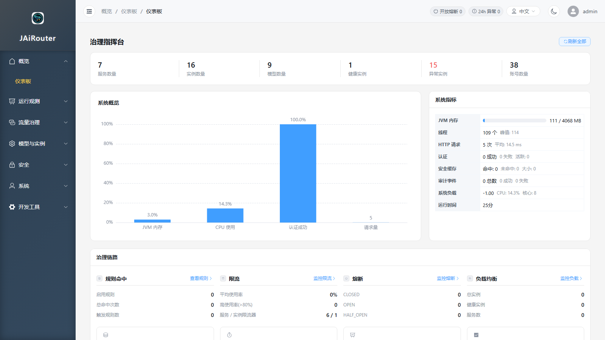
  <br/>
  <em>仪表盘 —— 实时的服务、实例与系统指标</em>
</p>

<p align="center">
  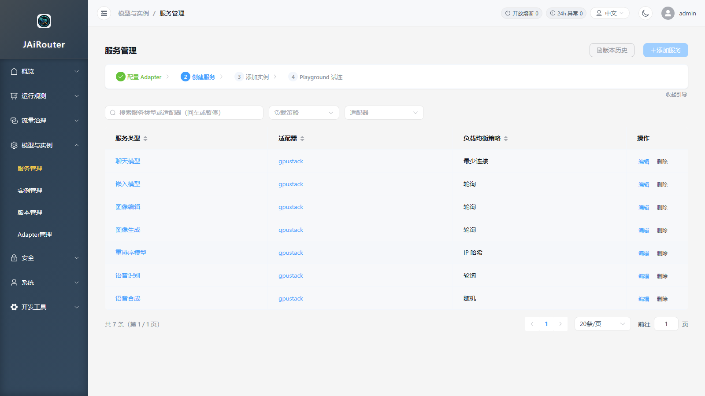
  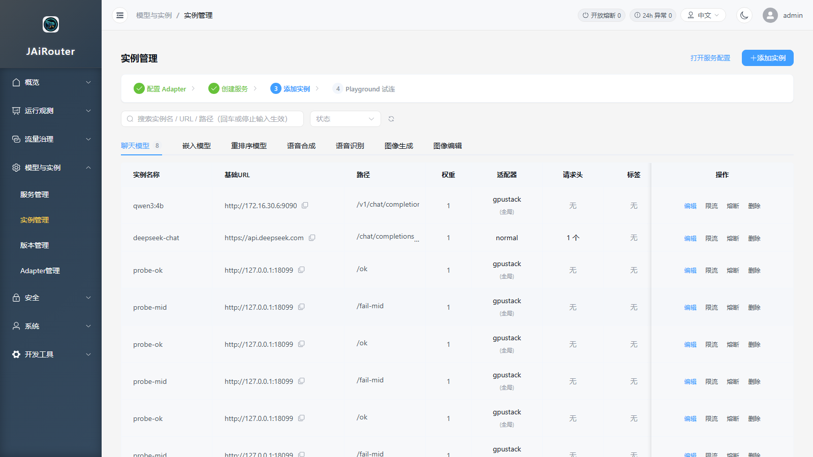
  <br/>
  <em>服务与实例管理 —— 每个服务的适配器与负载均衡策略</em>
</p>

<p align="center">
  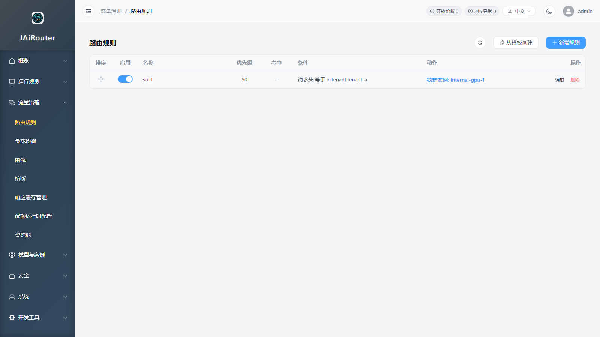
  <br/>
  <em>可视化路由规则 —— 命中统计、优先级拖拽与模板</em>
</p>

<p align="center">
  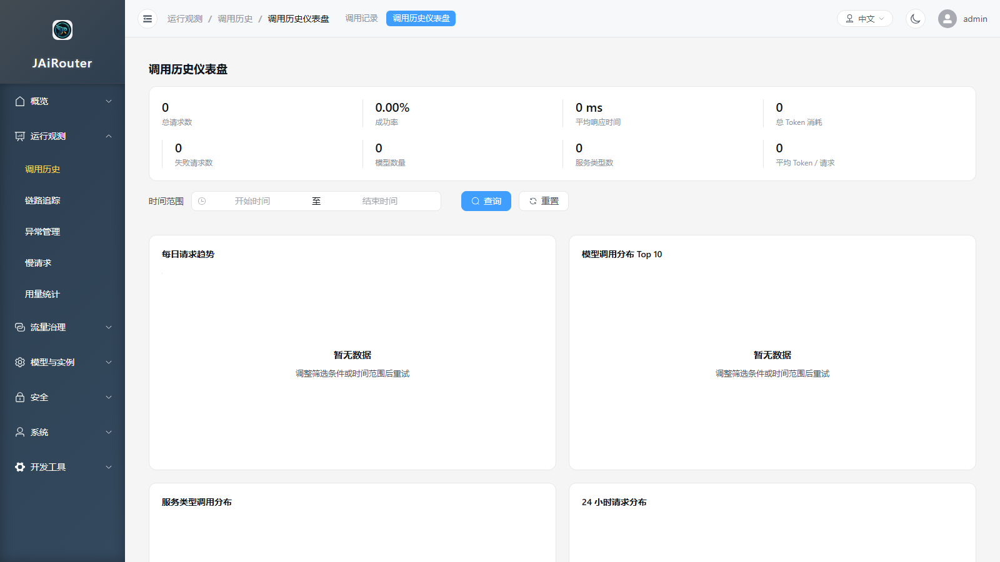
  <br/>
  <em>调用历史分析 —— 成功率、延迟与 Token 用量趋势</em>
</p>

<p align="center">
  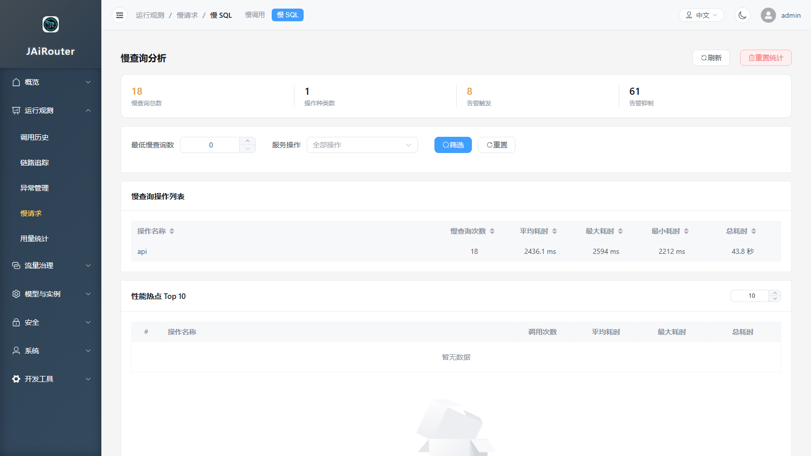
  <br/>
  <em>慢查询分析 —— 热点、告警状态与操作分布</em>
</p>

<p align="center">
  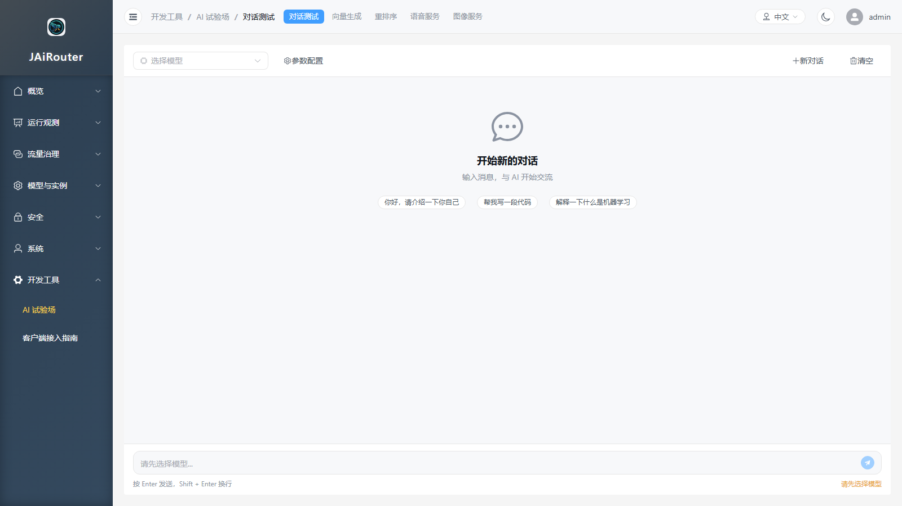
  <br/>
  <em>演练场 —— 对话、向量化、重排、语音与图像测试台</em>
</p>

<p align="center">
  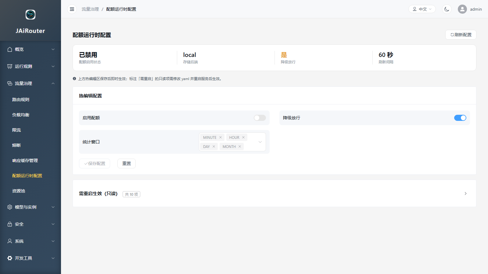
  <br/>
  <em>配额运行时配置 —— 仅重启生效的字段为只读并带角标</em>
</p>

<p align="center">
  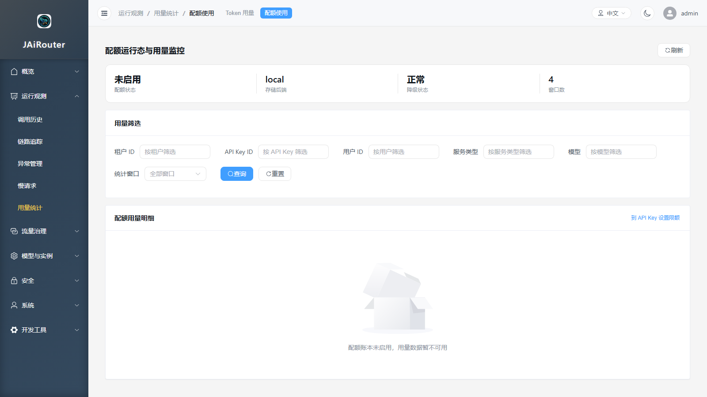
  <br/>
  <em>配额监控 —— 后端类型、降级状态与多维度筛选</em>
</p>

<p align="center">
  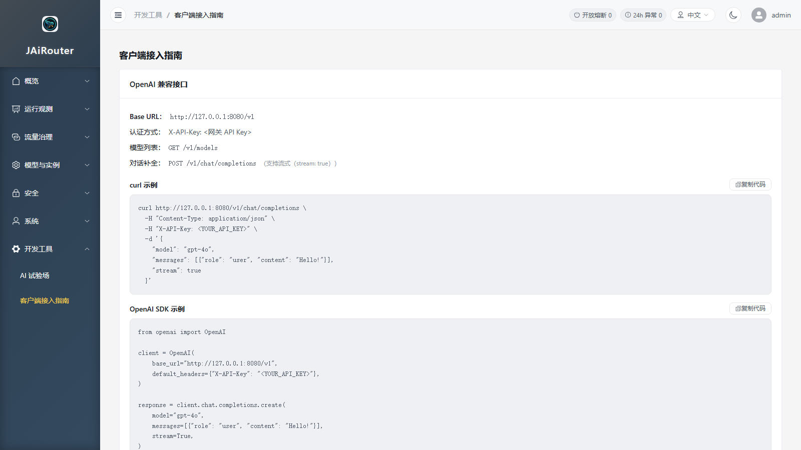
  <br/>
  <em>客户端接入指引 —— OpenAI 兼容与 Anthropic base URL 的可复制片段</em>
</p>

<p align="center">
  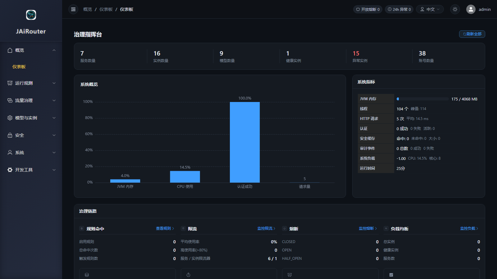
  <br/>
  <em>内置暗色主题 —— 界面可换肤、双语</em>
</p>

</details>

## 状态与近期工作

**最新发布：v3.3.0（2026-10-07）** —— 接入 PostgreSQL 并以 `Flyway` 管理版本化迁移；多副本能力
（跨副本事件广播、共享计数、启动自检、定时任务按类处置）；以及一轮「配置诚实性」收口：把没人消费的
配置键逐个接上消费方或删除。

**v3.3.0 之后已合入、尚未发布**（自该 tag 起 53 次提交 —— 39 次实质改动 + 14 次自动化的文档版本号提交；
2026-10-07 → 2026-10-13）—— 一轮由安全/质量审计驱动的加固，另加一轮「配置诚实性」收口。按主题归类：

| 主题 | 变更内容 |
|------|----------|
| Reactor 正确性 | 阻塞写库移出事件循环（API Key 用量、错误上报）；JWT 黑名单同步改为锁外批量 |
| 流式保真 | `/v1` 面：下游在响应提交前失败时补协议形状 error 帧并保持状态码保真；legacy `/api/**` 语义有意不动；两个探针测试类把客户端可见基线钉住 |
| 告警 | `SecurityAlertService` 接到认证失败路径、判据对齐审计事件枚举、计数下沉到存储侧、配置面统一、冷却改为跨副本排他，并清掉残余死告警配置 |
| 审计事件类型 | 事件类型一律走枚举名；`parseEventType` 不再静默回退成 `SYSTEM_MAINTENANCE`（枚举 17 → 26），未知动态前缀改为显式降级而非被丢弃 |
| 安全 | SSRF：解析结果与建连绑定（堵 DNS 重绑定）；Token 用量写入按主体收敛属主；配置推送与指标上报的出站客户端收归共享 WebClient 池 |
| 配置诚实性 | 两棵「能设、不报错、没人读」的配置树已删除（`jairouter.security.audit` 下 7 个子块，以及整棵 `jairouter.security.performance`：4 个文件 21 个键）；`AuditConfig.storage` / `alertEnabled` 一并删除；两条守卫测试现在会让这类键「复活」时直接构建失败 |
| 死代码 | 删除不可达的认证 provider/listener、无生产方的 DTO、无引用的模块边界接口、无引用的前端 composable |
| 文档与门闩 | 多处文档与代码口径对齐（16 篇里从未生效的配置示例，以及两处完全虚构的审计小节）；贡献文档新增「怎么读 CI 门闩」；修复拼写检查词表 |

发布标签：`v3.3.0` · `v3.2.2` · `v3.2.1` · `v3.2.0` · `v3.1.2` · `v3.1.1`。

### 开放台账

**本文件刻意不再维护一份手写的 issue 编号清单。** 早先版本这么做，结果是**写出来几小时内就过期**。
权威台账在 issue 跟踪器：**[开放 issue →](https://github.com/Lincoln-cn/JAiRouter/issues?q=is%3Aissue+is%3Aopen)**

下面用来说明台账里**通常有哪些类**的条目（**仅示意、不是当前清单**，当前集合请点上面的链接）：

- **只有单测覆盖的行为** —— 真实运行态接线没有端到端证据的路径（例如告警链路与流式错误路径）。
- **会撒谎的形状** —— 声明的类型/接口与运行态实际产出不一致，工具因此无法约束它。
- **面向运维的错误文案** —— 启动提示或文档描述了代码并不会做的事。
- **靠惯性留着的死面** —— 没有消费方的配置键、DTO 或接口。
- **文档欠账** —— 到期待复审，或渲染已经坏掉的页面。

若某件事既不在上面这些类里、也不在跟踪器里，请按**未知**对待，而不要假定它可用。

## 文档

| 资源 | 链接 |
|------|------|
| 完整文档 | https://jairouter.com |
| 部署 | https://jairouter.com/deployment/ |
| 配置 | https://jairouter.com/configuration/ |
| 监控 | https://jairouter.com/monitoring/ |
| 交互式 API 文档 | `http://localhost:8080/swagger-ui`（dev profile） |

## 为什么选 JAiRouter？

- **对比直连后端** —— 没有共享的韧性、没有中心化凭据、没有用量可见性。JAiRouter 给你一个端点、
  自动失败转移与完整审计轨迹。
- **对比 One-API / new-api** —— 它们面向共享账号的分发与计费。JAiRouter 是**你自己**推理集群前面的
  那层网关：多实例均衡、熔断、规则路由、自托管 Ollama/vLLM/GPUStack 的 RBAC 与可观测性。两者互补。
- **对比 Nginx** —— Nginx 是通用 Web 服务器；JAiRouter 为模型负载而建：OpenAI 兼容路由、
  模型感知均衡、流式语义。
- **对比 LangChain** —— LangChain 是应用框架；JAiRouter 是它下面的基础设施层。

| 能力 | JAiRouter | Nginx | One-API | LangChain |
|------|:---------:|:-----:|:-------:|:---------:|
| OpenAI 兼容 | ✅ | ❌ | ✅ | ✅ |
| 负载均衡 | ✅ | ✅ | ✅ | ❌ |
| 熔断 | ✅ | ❌ | ❌ | ❌ |
| 限流 | ✅ | ✅ | ✅ | ❌ |
| Web 控制台 | ✅ | ❌ | ✅ | ❌ |
| 配置热重载 | ✅ | ❌ | ✅ | ❌ |
| 版本管理 | ✅ | ❌ | ❌ | ❌ |
| OpenTelemetry | ✅ | ❌ | ❌ | ✅ |

## 参与贡献

欢迎贡献——见[贡献指南](https://jairouter.com/development/contributing/)。

提 PR 前请先跑：

```bash
./mvnw test -o                       # 388 个测试类、约 4000 个测试方法，必须保持全绿
cd frontend && npm run type-check    # 前端类型门闩
```

几条仓内约定：提交信息用 `<type>(<scope>): <summary>`；每个修复/功能分支都指向 `master` 并以
squash 方式合并；文档同时存在于 `docs/zh/` 与 `docs/en/` 且要求保持对称；文档会按 `.cspell.json`
做拼写检查，新技术名词可能需要先加进词表。

```bash
git clone https://github.com/Lincoln-cn/JAiRouter.git
cd JAiRouter
./mvnw clean package -DskipTests
java -jar target/model-router-*.jar
```

## 支持

- **文档**：https://jairouter.com

### 该发 Issue 还是 Discussion？

GitHub 给了我们两个渠道，我们有意分开，避免信息丢失。按**你手上有什么**来选：

| 你有什么 | 发到哪里 | 我们怎么处理 |
|----------|----------|--------------|
| **可复现的缺陷** —— 崩溃、结果错误、回归、文档写错 | [**Issues**](https://github.com/Lincoln-cn/JAiRouter/issues) | 快速分诊；确认的缺陷会被修复或排期 |
| **需求或想法** —— 功能请求、新适配器、设计讨论、使用提问 | [**Discussions**](https://github.com/Lincoln-cn/JAiRouter/discussions) | 定期梳理，收集与投票后并入路线图 |

**一句话**：缺陷发 **Issues**；需求或提问发 **Discussions**。

> 拿不准？先发 Discussions——如果最后确认是可复现的缺陷，我们会帮你转到 Issues。

Discussions 按分类组织：

| 分类 | 用途 |
|------|------|
| 💡 Ideas | 功能请求与改进建议 |
| 🗳 Polls | 社区对方向的投票 |
| 🙏 Q&A | 使用问题互助 |
| 🙌 Show and tell | 分享你基于 JAiRouter 做的东西 |
| 💬 General | 其它 |
| 📣 Announcements | 维护者的发布说明 |

## 许可

JAiRouter 基于 [Apache 2.0 许可](LICENSE) 发布。

---

<p align="center">
  <strong>如果 JAiRouter 帮你省了时间，<a href="https://github.com/Lincoln-cn/JAiRouter/stargazers">在 GitHub 上点个 Star</a> ⭐</strong>
  <br/>
  <em>发现 bug？开 issue。有想法或疑问？开 discussion。</em>
</p>

<p align="center">
  Maintained by Lincoln-cn · Apache-2.0
</p>
