# JAiRouter

<p align="center">
  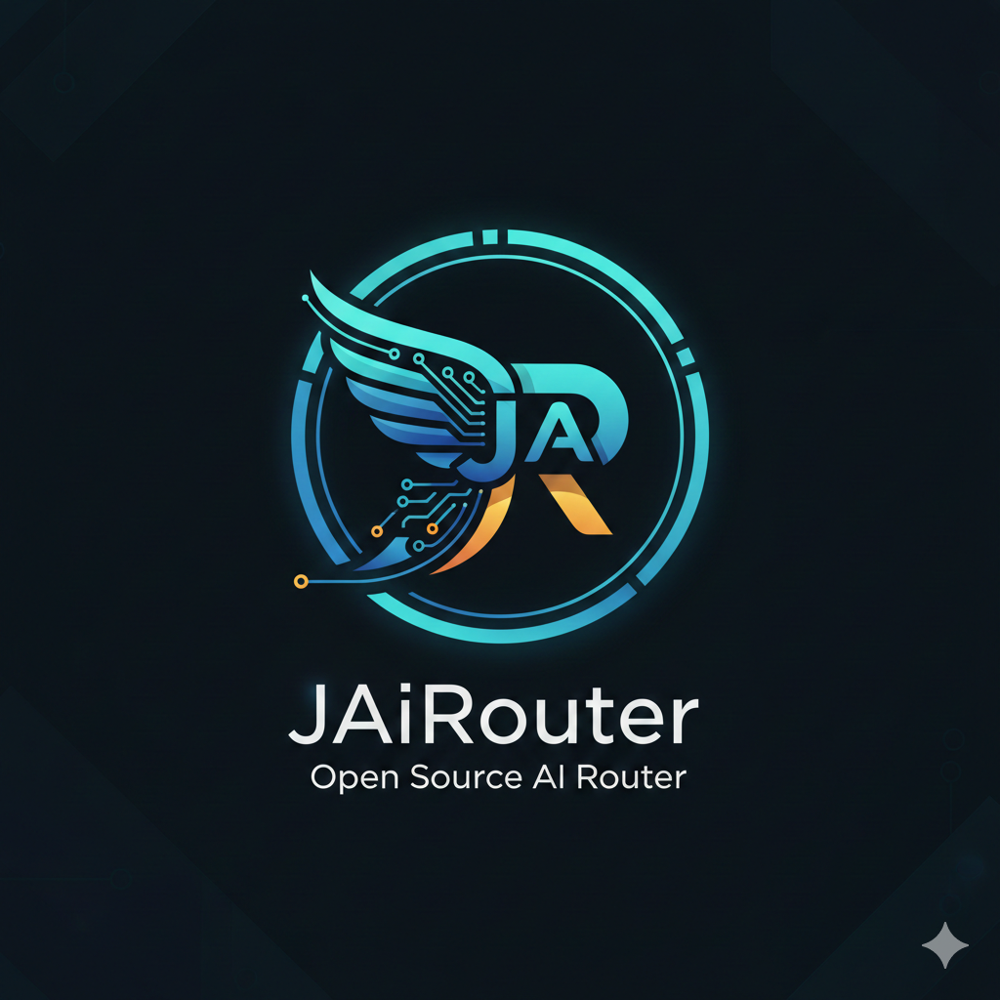
</p>

<p align="center">
  <strong>One OpenAI-compatible endpoint in front of every model backend you run.</strong>
</p>

<p align="center">
  Ollama · vLLM · GPUStack · Xinference · LocalAI · OpenAI · Claude · Gemini<br>
  Routing · load balancing · rate limiting · circuit breaking · failover · RBAC · audit · visual console
</p>

<p align="center">
  <em>Java + Spring Boot — built for teams whose stack already speaks JVM.</em>
</p>

<p align="center">
  <a href="https://github.com/Lincoln-cn/JAiRouter/releases">
    
  </a>
  <a href="https://hub.docker.com/r/sodlinken/jairouter">
    
  </a>
  <a href="https://github.com/Lincoln-cn/JAiRouter/blob/master/LICENSE">
    
  </a>
</p>

<p align="center">
  <a href="README-ZH.md">中文</a> •
  <a href="https://jairouter.com">Docs</a> •
  <a href="https://github.com/Lincoln-cn/JAiRouter/issues">Issues</a> •
  <a href="https://github.com/Lincoln-cn/JAiRouter/discussions">Discussions</a>
</p>

This README is written to be read by **people and AI agents alike**: the facts block below and the
[Repository map](#repository-map) / [Commands](#commands) / [HTTP surfaces](#http-surfaces) sections
are the machine-actionable core. Where the code and this file disagree, the code wins — please open
an issue so we can fix the file.

<!-- Canonical facts. Keep in sync with pom.xml, application*.yml and the workflow files. -->
```yaml
product:         JAiRouter
repository:      Lincoln-cn/JAiRouter
checkout_dir:    model-router            # the local/git directory name differs from the product name
artifact:        model-router            # Maven artifactId
project_version: 3.8.2                   # pom.xml
latest_release:  v3.8.2 (2026-11-12)
stack:
  backend:  Java 17 + Spring Boot 4.1.2 (WebFlux / reactive)
  frontend: Vue 3 + TypeScript + Vite, bilingual zh-CN / en-US
  build:    Maven wrapper — ./mvnw (Unix) · .\mvnw.cmd (Windows)
runtime:
  default_port: 8080
  console:      /admin/
  swagger_ui:   dev profile only
  required_env_in_prod: [JWT_SECRET, INITIAL_ADMIN_PASSWORD]
  required_env_in_staging: [JWT_SECRET]
surfaces:
  - /v1/**        # client surface: OpenAI-native + Anthropic-compatible
  - /api/**       # management + legacy surface (RBAC-governed)
  - /actuator/**  # health, readiness, Prometheus
tests:
  command: ./mvnw test -o
  scale:   ~5,100 test methods across ~600 test classes
license: Apache-2.0
```

## Why this one

Most LLM gateways are Python (LiteLLM) or an existing gateway stack you have to adopt whole
(Kong, APISIX, Envoy). If your services are Spring Boot and your ops team already runs JVM
workloads in containers, JAiRouter is the same job done in a stack you already know how to
deploy, monitor and debug: one jar or one image, PostgreSQL or H2, Flyway migrations,
Micrometer and Prometheus, and a console that reads like an admin page.

It is not a universal proxy. It is an operable gateway for a small-to-mid deployment:
authorization down to permission codes, audit that survives review, and configuration you can
change without a restart.

## What it is

JAiRouter is a **self-hosted AI model gateway**. It puts one OpenAI-compatible endpoint in front of
the model servers you already run — Ollama, vLLM, GPUStack, Xinference, LocalAI — plus cloud
providers (OpenAI, Anthropic, Gemini, and any OpenAI-compatible vendor). Existing OpenAI SDK,
LangChain and LlamaIndex code keeps working: point `base_url` at the gateway and nothing else changes.

It then adds the layer you would otherwise build yourself: multi-instance load balancing, rate
limiting, circuit breaking with failover to a *different* healthy instance, RBAC, audit logging,
record governance and observability — all configurable at runtime from a web console, without
restarting the process.

| Problem | What JAiRouter does |
|---------|---------------------|
| Many model endpoints to manage | One unified API surface |
| Manual failover when a backend dies | Circuit breaker + request-level failover |
| Auth implemented per service | JWT + API key with data-driven RBAC |
| Logs and metrics scattered per backend | Central metrics, tracing, call history |
| Restart required for config changes | Hot reload from the console |

## Quick start

### 5-minute demo — no model service needed

Two containers and one script show the gateway end to end: request forwarding, model switching,
response cache, and reversible sanitization. A mock upstream stands in for a real model, so there is
no GPU to provision, no API key to obtain, and no JDK to install.

```bash
docker compose -f deploy/demo/docker-compose.yml pull        # v3.8.1 or newer
docker compose -f deploy/demo/docker-compose.yml up -d      # wait until both are healthy
node scripts/demo/run-demo.mjs
```

Full walkthrough, including how to check reversible sanitization from the upstream side:
[5-minute demo](docs/en/getting-started/demo.md).

### Development profile — no secrets required

```bash
docker run -d --name jairouter -p 8080:8080 \
  -e SPRING_PROFILES_ACTIVE=dev \
  sodlinken/jairouter:latest

# Console:      http://localhost:8080/admin/
# Default login: admin / ChangeMeOnFirstStartup123456
```

The dev profile intentionally falls back to built-in development secrets, so it starts with no
configuration at all. **Never expose a dev-profile instance to an untrusted network.**

### Production profile — secrets are required

```bash
docker run -d --name jairouter -p 8080:8080 \
  -e JWT_SECRET="$(openssl rand -base64 48)" \
  -e INITIAL_ADMIN_PASSWORD='<your-strong-admin-password>' \
  sodlinken/jairouter:latest
```

**Both variables are mandatory.** The `prod` profile performs a startup security gate and
**refuses to boot** when either is missing or still at its factory default — see
[Production startup gate](#production-startup-gate) for the exact rules. A container started with
only `JWT_SECRET` exits during startup with `IllegalStateException`.

If you boot the JAR directly rather than through Docker, generate strong values first:

```bash
java -jar target/model-router-*.jar --generate-key        # JWT secret
java -jar target/model-router-*.jar --generate-password   # admin password
```

### Point a client at it

```python
from openai import OpenAI

client = OpenAI(
    base_url="http://localhost:8080/v1",             # OpenAI-native surface (raw JSON / SSE)
    api_key="not-needed",                            # Authorization is forwarded downstream
    default_headers={"X-API-Key": "<your-api-key>"}  # gateway credential (Management API key)
)

response = client.chat.completions.create(
    model="llama3.2",                                # any model from your configured backends
    messages=[{"role": "user", "content": "Hello!"}]
)
print(response.choices[0].message.content)
```

Registered backends are managed from the console under **Instance Management**; changes apply by hot
reload, with no restart.

## Production startup gate

The gate lives in `StartupSecretKeyChecker` (a `CommandLineRunner`) and
`StartupSecurityGate`. It runs on every start and reads **environment variables directly** — setting
the equivalent YAML property is *not* enough to satisfy it:

| Check | Rule when the profile is `prod` / `production` | Rule otherwise |
|-------|-----------------------------------------------|----------------|
| JWT enabled | `jairouter.security.jwt.enabled` must be `true`, otherwise fail | not checked |
| `JWT_SECRET` | must be set, not a known factory/doc default, and not rate `VERY_WEAK` / `WEAK` | warn only |
| `INITIAL_ADMIN_PASSWORD` | must be set, except for the factory default `ChangeMeOnFirstStartup123456`, and not rate `VERY_WEAK` / `WEAK` | warn only |

Details worth knowing:

- **A missing `INITIAL_ADMIN_PASSWORD` is a hard failure in production.** It is the only name the
  configuration binding reads — the legacy `ADMIN_PASSWORD` alias is gone — and nothing is generated for you.
- **No password is auto-generated in `prod`.** If neither variable is set, startup aborts; it does not
  fall back to the documented default. (The only generators are the explicit CLI flags
  `--generate-key` / `--generate-password`.) Outside `prod`, the base configuration falls back to a
  random value rather than a public one, and prints it once in the startup log.
- A `MEDIUM`-strength value logs a warning and **allows** startup; `VERY_WEAK` / `WEAK` blocks it.
- Escape hatch for trusted isolated networks: `JAIRouter_SKIP_AUTH_WARNING=true`. It must be set
  explicitly and it disables the gate for **all** of the checks above.
- The `admin` account itself comes from `jairouter.security.jwt.accounts` in
  `src/main/resources/config/auth/jwt.yml`, whose password is
  `{noop}${INITIAL_ADMIN_PASSWORD:${random.uuid}}` (random fallback outside `prod`, no public literal).
  On first start those YAML accounts
  are copied into the `jwt_accounts` table **only when that table is empty**
  (`JpaDatabaseInitializer.initializeJwtAccounts`); later starts leave the table untouched, so
  rotating `INITIAL_ADMIN_PASSWORD` does **not** change an account that already exists in the
  database — change it in the console instead.

## Repository map

| Path | What lives there |
|------|------------------|
| `src/main/java/org/unreal/modelrouter/router/` | Gateway core: adapters, request processors, load balancers, rule engine, circuit breaker, cache |
| `src/main/java/org/unreal/modelrouter/auth/` | Authentication (JWT, API key), sanitization, security audit, RBAC, console-facing auth APIs |
| `src/main/java/org/unreal/modelrouter/monitor/` | Metrics, tracing, call history, slow-query analysis, error tracking, security alerts |
| `src/main/java/org/unreal/modelrouter/persistence/` | Store abstractions plus JPA entities/repositories and schema initialization |
| `src/main/java/org/unreal/modelrouter/config/` | Configuration service: hot reload, versioning/rollback, validation, console API |
| `src/main/resources/config/**` | Modular YAML config, imported via `spring.config.import` in `application.yml` |
| `src/main/resources/db/migration/{h2,postgres}/` | Versioned schema migrations (`Flyway`), one dialect directory each |
| `src/test/java/` | JUnit 5 + Mockito + Reactor `StepVerifier`; ~5,100 test methods |
| `frontend/` | Vue 3 + TypeScript console (Vite `base: /admin/`) |
| `docs/zh/`, `docs/en/` | MkDocs documentation, kept symmetrical |
| `deploy/` | Kubernetes manifests, compose files, deployment scripts |
| `.cspell.json` | Spell-check word list — the docs workflow fails on unknown words |
| `innerdoc/` | Internal design notes, not published |

## Commands

```bash
# Build (skipping tests)
./mvnw clean package -DskipTests

# Run locally
java -jar target/model-router-*.jar --spring.profiles.active=dev

# Full Java test suite (offline works; -Dcheckstyle.skip etc. speed up iteration)
./mvnw test -o

# Focused test run — comma-separated class filter, no wildcards
./mvnw test -Dtest=FooTest,BarTest -DfailIfNoTests=false -o

# Frontend (type-check + build)
cd frontend && npm ci && npm run type-check && npm run build
```

Windows: substitute `.\mvnw.cmd` for `./mvnw`.

## HTTP surfaces

| Surface | Prefix | Protocol | Auth |
|---------|--------|----------|------|
| Client — OpenAI-native | `/v1/**` | OpenAI JSON + SSE (`/v1/chat/completions`, `/v1/models`, `/v1/embeddings`, `/v1/rerank`) | JWT or API key |
| Client — Anthropic-compatible | `/v1/messages`, `/v1/messages/count_tokens` | Anthropic Messages (streaming SSE, tool use) | JWT or API key |
| Management | `/api/**` | JSON, `RouterResponse` envelope | JWT/API key + RBAC URL matrix |
| Operations | `/actuator/**` | Health, readiness, `/actuator/prometheus` | depends on profile |

Error bodies are protocol-shaped per surface: on `/v1/messages` an Anthropic-shaped
`{"type":"error","error":{...}}`, on the other `/v1/**` paths an OpenAI-shaped
`{"error":{message,type,code}}`, and `/api/**` keeps its legacy shape. Streaming failures on the
`/v1` surface emit a protocol-shaped error frame **and** still terminate the stream with an error —
`[DONE]` is never appended to a failed stream, because clients treat `[DONE]` as success.

## Authentication and authorization

- **JWT** — header name is configurable, default `Jairouter_Token`.
- **API key** — header `X-API-Key`. Gateway credentials are separate from downstream provider keys:
  `x-api-key` is consumed by the gateway and never forwarded, so per-instance downstream credentials
  belong in the instance's own `headers.Authorization`.
- **RBAC** — data-driven: 63 permission codes, 4 role templates (`ADMIN` / `OPERATOR` / `USER` /
  `VIEWER`), a URL rule matrix plus method-level `@PreAuthorize`. Requests that match no rule follow
  `jairouter.security.rbac.unmatched-policy`, whose default is `DENY_ALL`; `ROLE_ADMIN` short-circuits
  everything. `/v1/**` is authenticated but intentionally outside the permission matrix.

## Feature inventory

Implemented and exercised by the test suite:

- **Adapters** — Ollama, vLLM, GPUStack, Xinference, LocalAI, OpenAI, Anthropic (native), Gemini
  (native), plus any OpenAI-compatible provider declared in `adapter-definitions`.
- **Load balancing** — round-robin, weighted, least-connections, IP hash, consistent hash, EWMA
  latency-aware, random.
- **Rule engine** — conditional routing on model, service type, header, client IP, weight and
  instance tags, with hit statistics; visual editing in the console.
- **Resilience** — circuit breaker per instance, request-level failover to another healthy instance,
  rate limiting (token bucket / leaky bucket / sliding window), response cache for deterministic
  requests (opt-in, tenant-isolated keys).
- **Quota** — multi-dimensional, multi-window ledger (MINUTE/HOUR/DAY/MONTH) with Redis distributed
  counting and local fallback (`jairouter.quota.enabled`, off by default).
- **Record governance** — call history at three levels: metadata only, desensitized summary, or
  AES-256-GCM-encrypted full content; ADMIN-only decryption endpoint.
- **Observability** — Prometheus metrics, OpenTelemetry tracing, slow-query analysis, error tracking,
  security alerts. Alert outlets are deliberately limited to **Prometheus metrics + structured logs** —
  the repository implements no push channels (email/webhook/IM); wire those up in Alertmanager or your
  log platform.
- **Persistence** — H2 by default; PostgreSQL (with `Flyway` migrations) when `DATABASE_URL` points at
  it; Redis for shared state in multi-replica deployments.
- **Multi-replica** — cross-replica event broadcast, shared rate-limit/quota counters, and a
  distributed lock for scheduled tasks (including the alert cooldown).
- **Console** — Vue 3 SPA at `/admin/`: services, instances, adapters, rules, versions & rollback,
  quota, call history, tracing, alerts, API keys, RBAC, dark/light theme, zh-CN / en-US.

Not implemented: in-repo notification delivery. A **semantic cache** (SimHash near-match reuse of
non-streaming responses) exists but is off by default — see `jairouter.semantic-cache.enabled`.
See the [changelog](docs/en/reference/changelog.md) for per-release notes.

## Architecture

<details>
<summary><b>Request flow</b></summary>

```
┌─────────────────────────────────────────────────────────────────┐
│                         Your Application                         │
│                 (OpenAI SDK / LangChain / LlamaIndex)           │
└─────────────────────────────────┬───────────────────────────────┘
                                  │
                                  ▼ OpenAI-Compatible API
┌─────────────────────────────────────────────────────────────────┐
│                         JAiRouter Gateway                        │
│  ┌─────────┐ ┌─────────┐ ┌─────────┐ ┌─────────┐ ┌─────────┐   │
│  │ Routing │ │ Balance │ │  Limit  │ │ Circuit │ │   Auth  │   │
│  └─────────┘ └─────────┘ └─────────┘ └─────────┘ └─────────┘   │
│  ┌─────────────────────────────────────────────────────────┐   │
│  │              Observability & Persistence                 │   │
│  └─────────────────────────────────────────────────────────┘   │
└─────────────────────────────────┬───────────────────────────────┘
                                  │
       ┌──────────────┬───────────┼───────────┬──────────────┐
       ▼              ▼           ▼           ▼              ▼
   ┌───────┐     ┌───────┐   ┌───────┐   ┌──────────┐   ┌───────┐
   │Ollama │     │ vLLM  │   │GPUStack│  │Xinference│   │ OpenAI │
   └───────┘     └───────┘   └───────┘   └──────────┘   └───────┘
```

</details>

<details>
<summary><b>Console screenshots</b></summary>

<p align="center">
  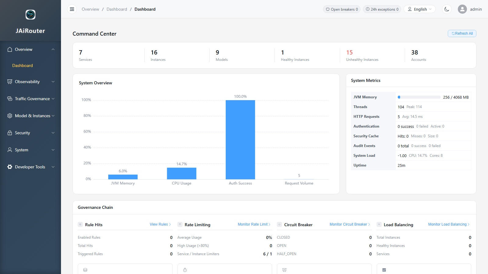
  <br/>
  <em>Dashboard — real-time service, instance and system metrics</em>
</p>

<p align="center">
  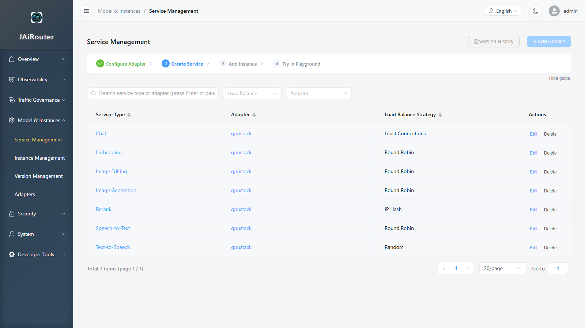
  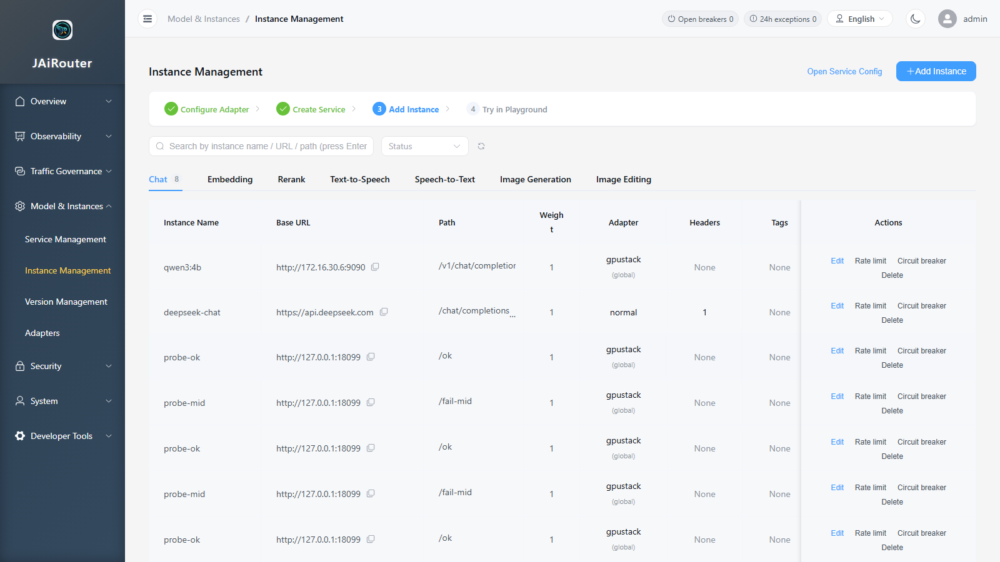
  <br/>
  <em>Service & instance management — adapters and load-balancing strategies per service</em>
</p>

<p align="center">
  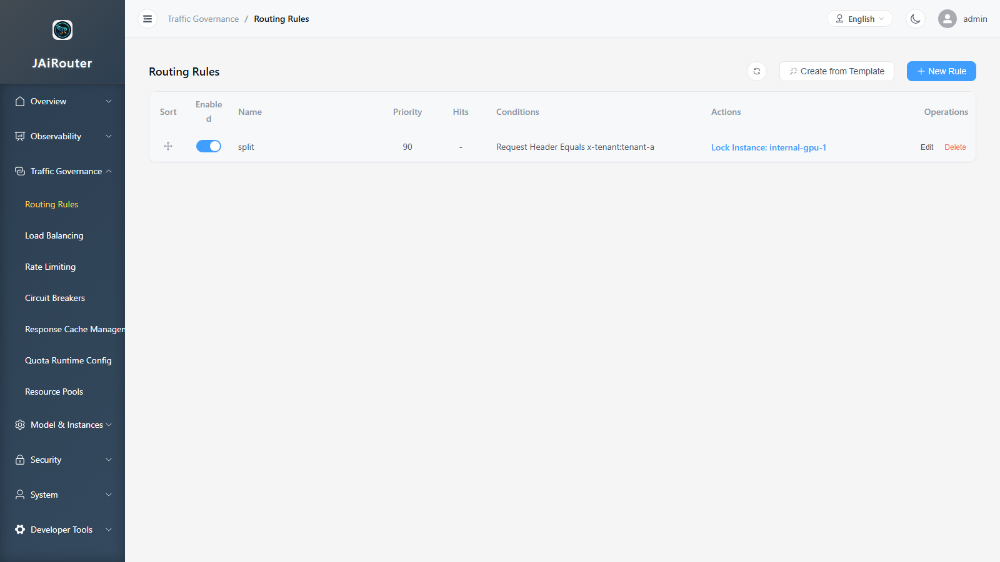
  <br/>
  <em>Visual routing rules with hit statistics, priority drag-and-drop and templates</em>
</p>

<p align="center">
  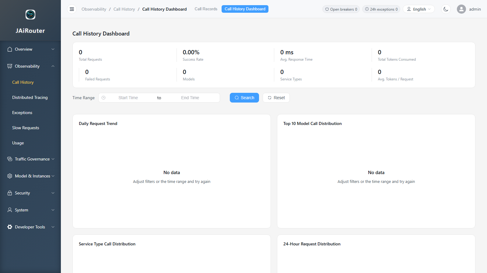
  <br/>
  <em>Call history analytics — success rate, latency and token usage trends</em>
</p>

<p align="center">
  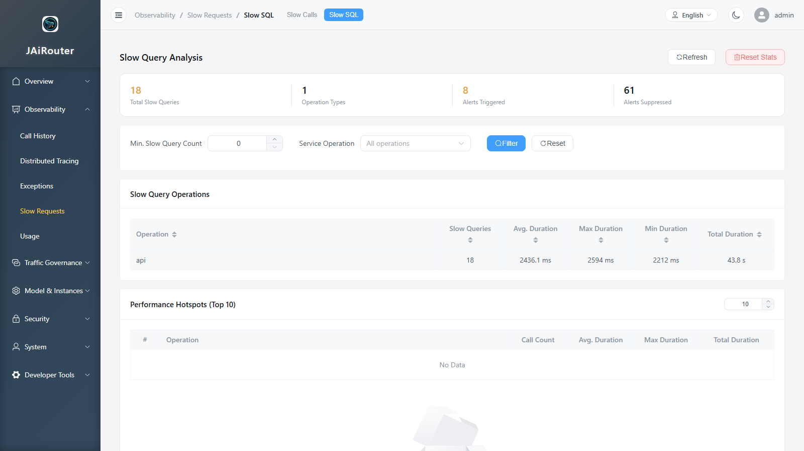
  <br/>
  <em>Slow-query analysis — hotspots, alert status and operation breakdown</em>
</p>

<p align="center">
  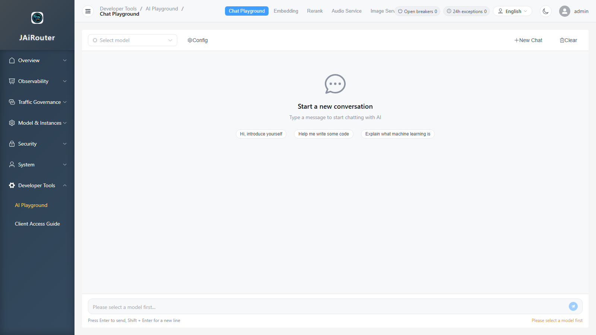
  <br/>
  <em>Playground — chat, embedding, rerank, audio and image test benches</em>
</p>

<p align="center">
  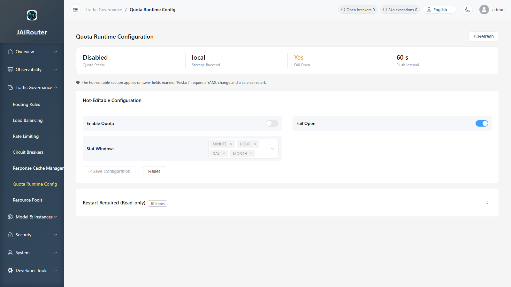
  <br/>
  <em>Quota runtime configuration — restart-required fields are read-only with a badge</em>
</p>

<p align="center">
  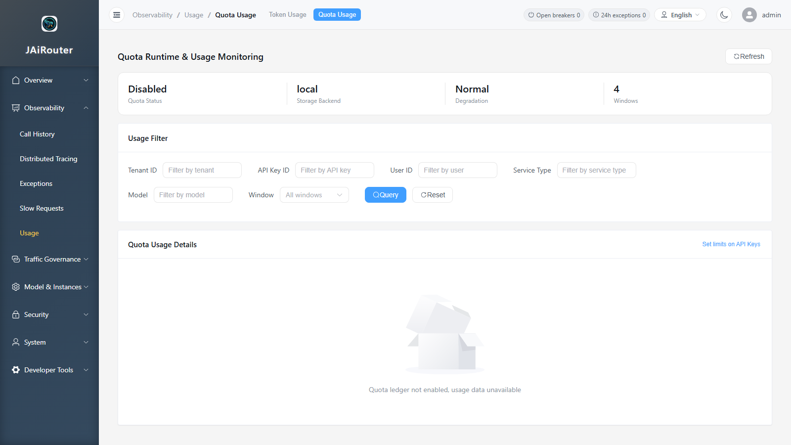
  <br/>
  <em>Quota monitoring — backend type, degradation status and multi-dimensional filtering</em>
</p>

<p align="center">
  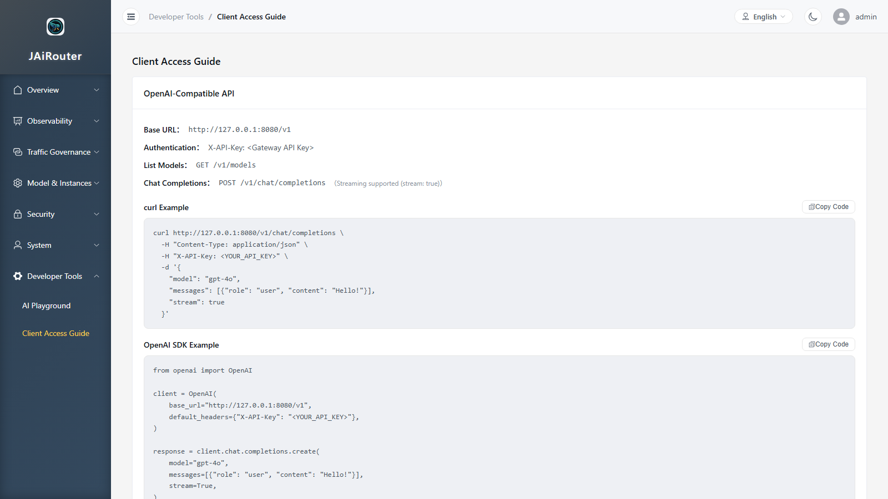
  <br/>
  <em>Client access guide — copy-ready snippets for the OpenAI-compatible and Anthropic base URLs</em>
</p>

<p align="center">
  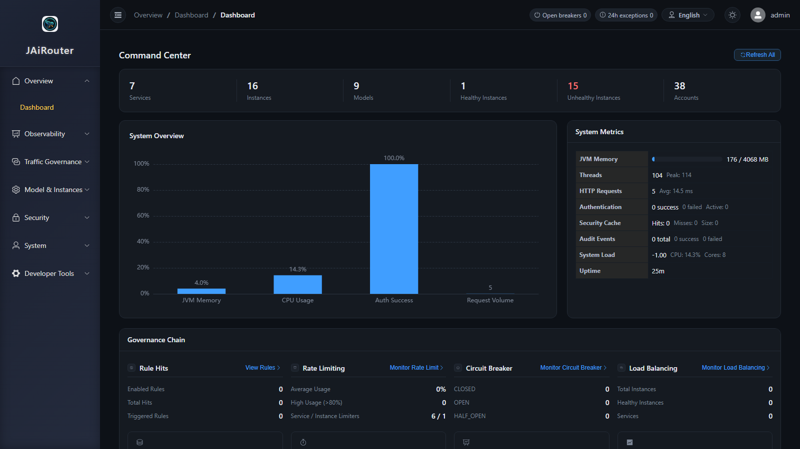
  <br/>
  <em>Built-in dark theme — the console is themeable and bilingual</em>
</p>

</details>

## Status

**Latest release: v3.8.1 (2026-11-08).** Per-release notes, upgrade notes and known limits live in the
[changelog](docs/en/reference/changelog.md); downloads and container tags are on
[Releases](https://github.com/Lincoln-cn/JAiRouter/releases).

This file deliberately does not repeat release history. It used to, and the copy fell five releases
behind the changelog — one source of truth is the only version that stays true.


## Documentation

| Resource | Link |
|----------|------|
| Full documentation | https://jairouter.com |
| Deployment | https://jairouter.com/en/deployment/ |
| Configuration | https://jairouter.com/en/configuration/ |
| Monitoring | https://jairouter.com/en/monitoring/ |
| Interactive API reference | `http://localhost:8080/swagger-ui` (dev profile) |

## Why JAiRouter?

- **vs calling backends directly** — no shared resilience, no central credentials, no usage
  visibility. JAiRouter gives one endpoint, automatic failover and a full audit trail.
- **vs One-API / new-api** — those distribute and bill API keys for shared accounts. JAiRouter is the
  gateway in front of **your own** inference cluster: multi-instance balancing, circuit breaking, rule
  routing and RBAC for self-hosted Ollama/vLLM/GPUStack. The two complement each other.
- **vs Nginx** — Nginx is a general-purpose web server. JAiRouter is purpose-built for model
  workloads: OpenAI-compatible routing, model-aware balancing, streaming semantics.
- **vs LangChain** — LangChain is an application framework. JAiRouter is the infrastructure layer
  beneath it.

| Feature | JAiRouter | Nginx | One-API | LangChain |
|---------|:---------:|:-----:|:-------:|:---------:|
| OpenAI compatible | ✅ | ❌ | ✅ | ✅ |
| Load balancing | ✅ | ✅ | ✅ | ❌ |
| Circuit breaker | ✅ | ❌ | ❌ | ❌ |
| Rate limiting | ✅ | ✅ | ✅ | ❌ |
| Web console | ✅ | ❌ | ✅ | ❌ |
| Config hot reload | ✅ | ❌ | ✅ | ❌ |
| Version control | ✅ | ❌ | ❌ | ❌ |
| OpenTelemetry | ✅ | ❌ | ❌ | ✅ |

## Contributing

Contributions are welcome — see the [Contributing Guide](https://jairouter.com/en/development/contributing/).

Security issues: please do not open a public issue — report them privately per [SECURITY.md](SECURITY.md).

Before opening a pull request:

```bash
./mvnw test -o                       # ~600 test classes, ~5,100 test methods, must stay green
cd frontend && npm run type-check    # the frontend type gate
```

House conventions worth knowing: commits use `<type>(<scope>): <summary>`; every fix/feature branch
targets `master` and is squash-merged; documentation exists in both `docs/zh/` and `docs/en/` and is
expected to stay symmetrical; docs are spell-checked against `.cspell.json`, so new technical terms
may need to be added there.

```bash
git clone https://github.com/Lincoln-cn/JAiRouter.git
cd JAiRouter
./mvnw clean package -DskipTests
java -jar target/model-router-*.jar
```

## Support

- **Documentation**: https://jairouter.com

### Issues or Discussions — where should I post?

GitHub gives us two channels and we keep them separate on purpose. Pick by **what you have**:

| What you have | Where to post | How we handle it |
|---------------|---------------|------------------|
| A **reproducible defect** — crash, wrong result, regression, wrong doc | [**Issues**](https://github.com/Lincoln-cn/JAiRouter/issues) | Triaged quickly; confirmed defects are fixed or scheduled |
| A **requirement or idea** — feature request, new adapter, design discussion, usage question | [**Discussions**](https://github.com/Lincoln-cn/JAiRouter/discussions) | Collected, voted on and folded into the roadmap |

**In one line**: a defect goes to **Issues**; a requirement or a question goes to **Discussions**.

> Not sure which one fits? Post in Discussions — if it turns out to be a reproducible defect, we will
> move it to Issues for you.

Discussions is organized by category:

| Category | Use it for |
|----------|------------|
| 💡 Ideas | Feature requests and improvement suggestions |
| 🗳 Polls | Community votes on direction |
| 🙏 Q&A | How-to questions for the community |
| 🙌 Show and tell | Share what you built on JAiRouter |
| 💬 General | Anything else |
| 📣 Announcements | Release notes from maintainers |

## License

JAiRouter is released under the [Apache 2.0 License](LICENSE).

---

<p align="center">
  <strong>If JAiRouter saves you time, <a href="https://github.com/Lincoln-cn/JAiRouter/stargazers">star it on GitHub</a> ⭐</strong>
  <br/>
  <em>Found a bug? Open an issue. Have an idea or a question? Start a discussion.</em>
</p>

<p align="center">
  Maintained by Lincoln-cn · Apache-2.0
</p>
