# JAiRouter

<p align="center">
  
</p>

<p align="center">
  <strong>One OpenAI-compatible endpoint in front of every model backend you run.</strong>
</p>

<p align="center">
  Ollama · vLLM · GPUStack · Xinference · LocalAI · OpenAI · Claude · Gemini<br>
  Routing · load balancing · rate limiting · circuit breaking · failover · RBAC · audit · visual console
</p>

<p align="center">
  <a href="https://github.com/Lincoln-cn/JAiRouter/releases">
    
  </a>
  <a href="https://hub.docker.com/r/sodlinken/jairouter">
    
  </a>
  <a href="https://github.com/Lincoln-cn/JAiRouter/blob/master/LICENSE">
    
  </a>
</p>

<p align="center">
  <a href="README-ZH.md">中文</a> •
  <a href="https://jairouter.com">Docs</a> •
  <a href="https://github.com/Lincoln-cn/JAiRouter/issues">Issues</a> •
  <a href="https://github.com/Lincoln-cn/JAiRouter/discussions">Discussions</a>
</p>

This README is written to be read by **people and AI agents alike**: the facts block below and the
[Repository map](#repository-map) / [Commands](#commands) / [HTTP surfaces](#http-surfaces) sections
are the machine-actionable core. Where the code and this file disagree, the code wins — please open
an issue so we can fix the file.

<!-- Canonical facts. Keep in sync with pom.xml, application*.yml and the workflow files. -->
```yaml
product:         JAiRouter
repository:      Lincoln-cn/JAiRouter
checkout_dir:    model-router            # the local/git directory name differs from the product name
artifact:        model-router            # Maven artifactId
project_version: 3.5.8                   # pom.xml
latest_release:  v3.5.8 (2026-10-31)
stack:
  backend:  Java 17 + Spring Boot 3.5.5 (WebFlux / reactive)
  frontend: Vue 3 + TypeScript + Vite, bilingual zh-CN / en-US
  build:    Maven wrapper — ./mvnw (Unix) · .\mvnw.cmd (Windows)
runtime:
  default_port: 8080
  console:      /admin/
  swagger_ui:   dev profile only
  required_env_in_prod: [JWT_SECRET, INITIAL_ADMIN_PASSWORD]
  required_env_in_staging: [JWT_SECRET]
surfaces:
  - /v1/**        # client surface: OpenAI-native + Anthropic-compatible
  - /api/**       # management + legacy surface (RBAC-governed)
  - /actuator/**  # health, readiness, Prometheus
tests:
  command: ./mvnw test -o
  scale:   ~4,100 test methods across ~400 test classes
license: Apache-2.0
```

## What it is

JAiRouter is a **self-hosted AI model gateway**. It puts one OpenAI-compatible endpoint in front of
the model servers you already run — Ollama, vLLM, GPUStack, Xinference, LocalAI — plus cloud
providers (OpenAI, Anthropic, Gemini, and any OpenAI-compatible vendor). Existing OpenAI SDK,
LangChain and LlamaIndex code keeps working: point `base_url` at the gateway and nothing else changes.

It then adds the layer you would otherwise build yourself: multi-instance load balancing, rate
limiting, circuit breaking with failover to a *different* healthy instance, RBAC, audit logging,
record governance and observability — all configurable at runtime from a web console, without
restarting the process.

| Problem | What JAiRouter does |
|---------|---------------------|
| Many model endpoints to manage | One unified API surface |
| Manual failover when a backend dies | Circuit breaker + request-level failover |
| Auth implemented per service | JWT + API key with data-driven RBAC |
| Logs and metrics scattered per backend | Central metrics, tracing, call history |
| Restart required for config changes | Hot reload from the console |

## Quick start

### Development profile — no secrets required

```bash
docker run -d --name jairouter -p 8080:8080 \
  -e SPRING_PROFILES_ACTIVE=dev \
  sodlinken/jairouter:latest

# Console:      http://localhost:8080/admin/
# Default login: admin / ChangeMeOnFirstStartup123456
```

The dev profile intentionally falls back to built-in development secrets, so it starts with no
configuration at all. **Never expose a dev-profile instance to an untrusted network.**

### Production profile — secrets are required

```bash
docker run -d --name jairouter -p 8080:8080 \
  -e JWT_SECRET="$(openssl rand -base64 48)" \
  -e INITIAL_ADMIN_PASSWORD='<your-strong-admin-password>' \
  sodlinken/jairouter:latest
```

**Both variables are mandatory.** The `prod` profile performs a startup security gate and
**refuses to boot** when either is missing or still at its factory default — see
[Production startup gate](#production-startup-gate) for the exact rules. A container started with
only `JWT_SECRET` exits during startup with `IllegalStateException`.

If you boot the JAR directly rather than through Docker, generate strong values first:

```bash
java -jar target/model-router-*.jar --generate-key        # JWT secret
java -jar target/model-router-*.jar --generate-password   # admin password
```

### Point a client at it

```python
from openai import OpenAI

client = OpenAI(
    base_url="http://localhost:8080/v1",             # OpenAI-native surface (raw JSON / SSE)
    api_key="not-needed",                            # Authorization is forwarded downstream
    default_headers={"X-API-Key": "<your-api-key>"}  # gateway credential (Management API key)
)

response = client.chat.completions.create(
    model="llama3.2",                                # any model from your configured backends
    messages=[{"role": "user", "content": "Hello!"}]
)
print(response.choices[0].message.content)
```

Registered backends are managed from the console under **Instance Management**; changes apply by hot
reload, with no restart.

## Production startup gate

The gate lives in `StartupSecretKeyChecker` (a `CommandLineRunner`) and
`StartupSecurityGate`. It runs on every start and reads **environment variables directly** — setting
the equivalent YAML property is *not* enough to satisfy it:

| Check | Rule when the profile is `prod` / `production` | Rule otherwise |
|-------|-----------------------------------------------|----------------|
| JWT enabled | `jairouter.security.jwt.enabled` must be `true`, otherwise fail | not checked |
| `JWT_SECRET` | must be set, not a known factory/doc default, and not rate `VERY_WEAK` / `WEAK` | warn only |
| `INITIAL_ADMIN_PASSWORD` | must be set, except for the factory default `ChangeMeOnFirstStartup123456`, and not rate `VERY_WEAK` / `WEAK` | warn only |

Details worth knowing:

- **A missing `INITIAL_ADMIN_PASSWORD` is a hard failure in production.** It is the only name the
  configuration binding reads — the legacy `ADMIN_PASSWORD` alias is gone — and nothing is generated for you.
- **No password is auto-generated in `prod`.** If neither variable is set, startup aborts; it does not
  fall back to the documented default. (The only generators are the explicit CLI flags
  `--generate-key` / `--generate-password`.) Outside `prod`, the base configuration falls back to a
  random value rather than a public one, and prints it once in the startup log.
- A `MEDIUM`-strength value logs a warning and **allows** startup; `VERY_WEAK` / `WEAK` blocks it.
- Escape hatch for trusted isolated networks: `JAIRouter_SKIP_AUTH_WARNING=true`. It must be set
  explicitly and it disables the gate for **all** of the checks above.
- The `admin` account itself comes from `jairouter.security.jwt.accounts` in
  `src/main/resources/config/auth/jwt.yml`, whose password is
  `{noop}${INITIAL_ADMIN_PASSWORD:${random.uuid}}` (random fallback outside `prod`, no public literal).
  On first start those YAML accounts
  are copied into the `jwt_accounts` table **only when that table is empty**
  (`JpaDatabaseInitializer.initializeJwtAccounts`); later starts leave the table untouched, so
  rotating `INITIAL_ADMIN_PASSWORD` does **not** change an account that already exists in the
  database — change it in the console instead.

## Repository map

| Path | What lives there |
|------|------------------|
| `src/main/java/org/unreal/modelrouter/router/` | Gateway core: adapters, request processors, load balancers, rule engine, circuit breaker, cache |
| `src/main/java/org/unreal/modelrouter/auth/` | Authentication (JWT, API key), sanitization, security audit, RBAC, console-facing auth APIs |
| `src/main/java/org/unreal/modelrouter/monitor/` | Metrics, tracing, call history, slow-query analysis, error tracking, security alerts |
| `src/main/java/org/unreal/modelrouter/persistence/` | Store abstractions plus JPA entities/repositories and schema initialization |
| `src/main/java/org/unreal/modelrouter/config/` | Configuration service: hot reload, versioning/rollback, validation, console API |
| `src/main/resources/config/**` | Modular YAML config, imported via `spring.config.import` in `application.yml` |
| `src/main/resources/db/migration/{h2,postgres}/` | Versioned schema migrations (`Flyway`), one dialect directory each |
| `src/test/java/` | JUnit 5 + Mockito + Reactor `StepVerifier`; ~4,100 test methods |
| `frontend/` | Vue 3 + TypeScript console (Vite `base: /admin/`) |
| `docs/zh/`, `docs/en/` | MkDocs documentation, kept symmetrical |
| `deploy/` | Kubernetes manifests, compose files, deployment scripts |
| `.cspell.json` | Spell-check word list — the docs workflow fails on unknown words |
| `innerdoc/` | Internal design notes, not published |

## Commands

```bash
# Build (skipping tests)
./mvnw clean package -DskipTests

# Run locally
java -jar target/model-router-*.jar --spring.profiles.active=dev

# Full Java test suite (offline works; -Dcheckstyle.skip etc. speed up iteration)
./mvnw test -o

# Focused test run — comma-separated class filter, no wildcards
./mvnw test -Dtest=FooTest,BarTest -DfailIfNoTests=false -o

# Frontend (type-check + build)
cd frontend && npm ci && npm run type-check && npm run build
```

Windows: substitute `.\mvnw.cmd` for `./mvnw`.

## HTTP surfaces

| Surface | Prefix | Protocol | Auth |
|---------|--------|----------|------|
| Client — OpenAI-native | `/v1/**` | OpenAI JSON + SSE (`/v1/chat/completions`, `/v1/models`, `/v1/embeddings`, `/v1/rerank`) | JWT or API key |
| Client — Anthropic-compatible | `/v1/messages`, `/v1/messages/count_tokens` | Anthropic Messages (streaming SSE, tool use) | JWT or API key |
| Management | `/api/**` | JSON, `RouterResponse` envelope | JWT/API key + RBAC URL matrix |
| Operations | `/actuator/**` | Health, readiness, `/actuator/prometheus` | depends on profile |

Error bodies are protocol-shaped per surface: on `/v1/messages` an Anthropic-shaped
`{"type":"error","error":{...}}`, on the other `/v1/**` paths an OpenAI-shaped
`{"error":{message,type,code}}`, and `/api/**` keeps its legacy shape. Streaming failures on the
`/v1` surface emit a protocol-shaped error frame **and** still terminate the stream with an error —
`[DONE]` is never appended to a failed stream, because clients treat `[DONE]` as success.

## Authentication and authorization

- **JWT** — header name is configurable, default `Jairouter_Token`.
- **API key** — header `X-API-Key`. Gateway credentials are separate from downstream provider keys:
  `x-api-key` is consumed by the gateway and never forwarded, so per-instance downstream credentials
  belong in the instance's own `headers.Authorization`.
- **RBAC** — data-driven: 63 permission codes, 4 role templates (`ADMIN` / `OPERATOR` / `USER` /
  `VIEWER`), a URL rule matrix plus method-level `@PreAuthorize`. Requests that match no rule follow
  `jairouter.security.rbac.unmatched-policy`, whose default is `DENY_ALL`; `ROLE_ADMIN` short-circuits
  everything. `/v1/**` is authenticated but intentionally outside the permission matrix.

## Feature inventory

Implemented and exercised by the test suite:

- **Adapters** — Ollama, vLLM, GPUStack, Xinference, LocalAI, OpenAI, Anthropic (native), Gemini
  (native), plus any OpenAI-compatible provider declared in `adapter-definitions`.
- **Load balancing** — round-robin, weighted, least-connections, IP hash, consistent hash, EWMA
  latency-aware, random.
- **Rule engine** — conditional routing on model, service type, header, client IP, weight and
  instance tags, with hit statistics; visual editing in the console.
- **Resilience** — circuit breaker per instance, request-level failover to another healthy instance,
  rate limiting (token bucket / leaky bucket / sliding window), response cache for deterministic
  requests (opt-in, tenant-isolated keys).
- **Quota** — multi-dimensional, multi-window ledger (MINUTE/HOUR/DAY/MONTH) with Redis distributed
  counting and local fallback (`jairouter.quota.enabled`, off by default).
- **Record governance** — call history at three levels: metadata only, desensitized summary, or
  AES-256-GCM-encrypted full content; ADMIN-only decryption endpoint.
- **Observability** — Prometheus metrics, OpenTelemetry tracing, slow-query analysis, error tracking,
  security alerts. Alert outlets are deliberately limited to **Prometheus metrics + structured logs** —
  the repository implements no push channels (email/webhook/IM); wire those up in Alertmanager or your
  log platform.
- **Persistence** — H2 by default; PostgreSQL (with `Flyway` migrations) when `DATABASE_URL` points at
  it; Redis for shared state in multi-replica deployments.
- **Multi-replica** — cross-replica event broadcast, shared rate-limit/quota counters, and a
  distributed lock for scheduled tasks (including the alert cooldown).
- **Console** — Vue 3 SPA at `/admin/`: services, instances, adapters, rules, versions & rollback,
  quota, call history, tracing, alerts, API keys, RBAC, dark/light theme, zh-CN / en-US.

Deliberately **not** implemented: semantic (vector-similarity) cache and any in-repo notification
delivery. See [Status and recent work](#status-and-recent-work) for the open ledger.

## Architecture

<details>
<summary><b>Request flow</b></summary>

```
┌─────────────────────────────────────────────────────────────────┐
│                         Your Application                         │
│                 (OpenAI SDK / LangChain / LlamaIndex)           │
└─────────────────────────────────┬───────────────────────────────┘
                                  │
                                  ▼ OpenAI-Compatible API
┌─────────────────────────────────────────────────────────────────┐
│                         JAiRouter Gateway                        │
│  ┌─────────┐ ┌─────────┐ ┌─────────┐ ┌─────────┐ ┌─────────┐   │
│  │ Routing │ │ Balance │ │  Limit  │ │ Circuit │ │   Auth  │   │
│  └─────────┘ └─────────┘ └─────────┘ └─────────┘ └─────────┘   │
│  ┌─────────────────────────────────────────────────────────┐   │
│  │              Observability & Persistence                 │   │
│  └─────────────────────────────────────────────────────────┘   │
└─────────────────────────────────┬───────────────────────────────┘
                                  │
       ┌──────────────┬───────────┼───────────┬──────────────┐
       ▼              ▼           ▼           ▼              ▼
   ┌───────┐     ┌───────┐   ┌───────┐   ┌──────────┐   ┌───────┐
   │Ollama │     │ vLLM  │   │GPUStack│  │Xinference│   │ OpenAI │
   └───────┘     └───────┘   └───────┘   └──────────┘   └───────┘
```

</details>

<details>
<summary><b>Console screenshots</b></summary>

<p align="center">
  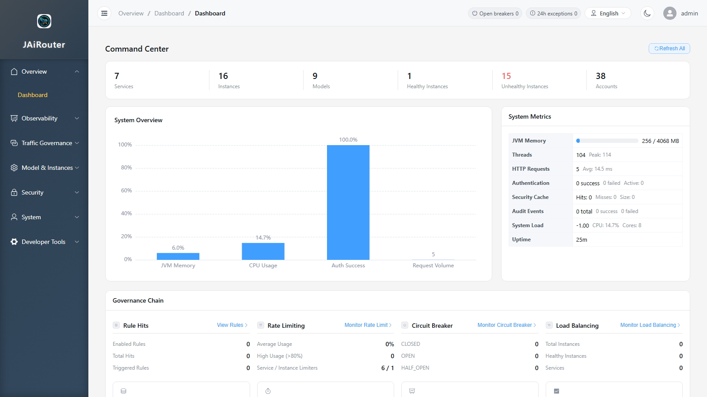
  <br/>
  <em>Dashboard — real-time service, instance and system metrics</em>
</p>

<p align="center">
  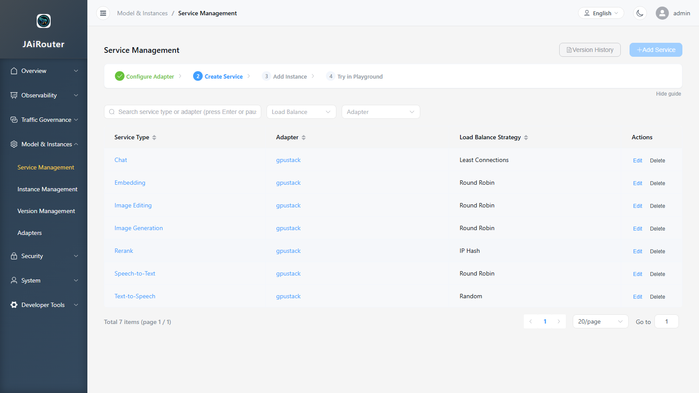
  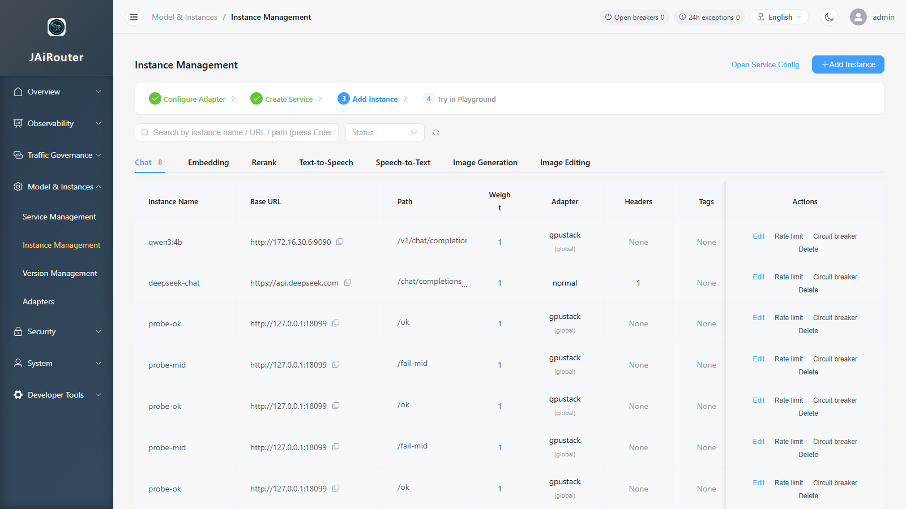
  <br/>
  <em>Service & instance management — adapters and load-balancing strategies per service</em>
</p>

<p align="center">
  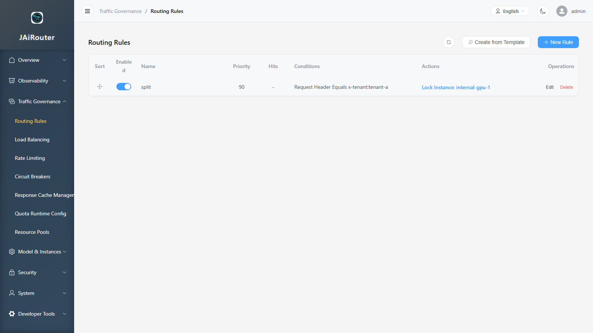
  <br/>
  <em>Visual routing rules with hit statistics, priority drag-and-drop and templates</em>
</p>

<p align="center">
  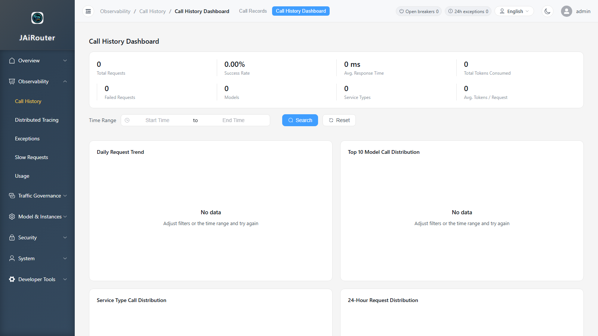
  <br/>
  <em>Call history analytics — success rate, latency and token usage trends</em>
</p>

<p align="center">
  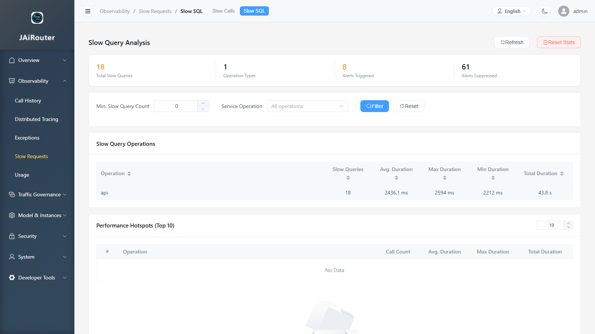
  <br/>
  <em>Slow-query analysis — hotspots, alert status and operation breakdown</em>
</p>

<p align="center">
  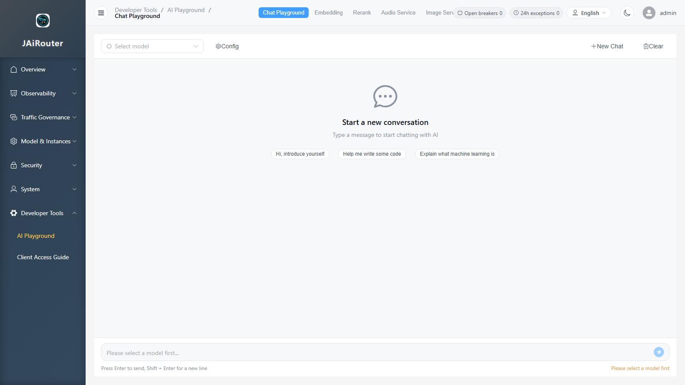
  <br/>
  <em>Playground — chat, embedding, rerank, audio and image test benches</em>
</p>

<p align="center">
  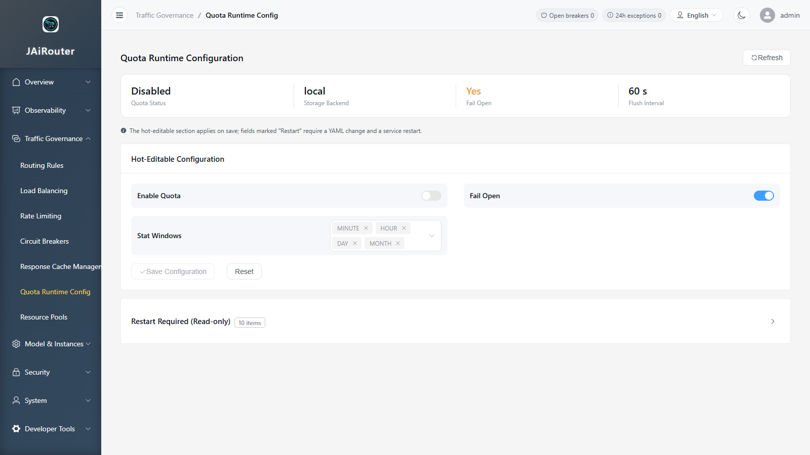
  <br/>
  <em>Quota runtime configuration — restart-required fields are read-only with a badge</em>
</p>

<p align="center">
  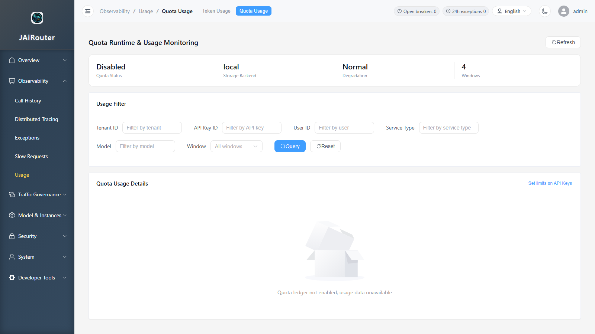
  <br/>
  <em>Quota monitoring — backend type, degradation status and multi-dimensional filtering</em>
</p>

<p align="center">
  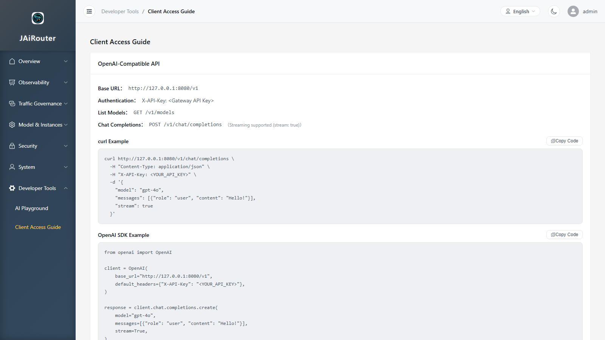
  <br/>
  <em>Client access guide — copy-ready snippets for the OpenAI-compatible and Anthropic base URLs</em>
</p>

<p align="center">
  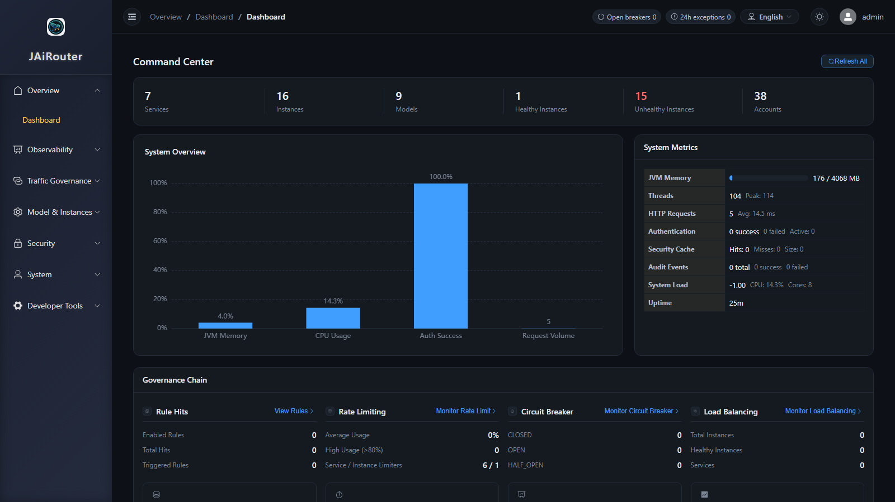
  <br/>
  <em>Built-in dark theme — the console is themeable and bilingual</em>
</p>

</details>

## Status and recent work

**Latest release: v3.5.8 (2026-10-31)** — the second audit pass: first the observability path, then every
remaining surface, which turned up two P0s in metrics/tracing and 19 correctness or honesty fixes.
**No API breaking changes; the upgrade notes below matter (health hysteresis, upload limit, audit-table migration).**

| Theme | What changed |
|-------|--------------|
| **The two P0s (#848 / #849)** | The async metrics processor no longer feeds its own output back into its queue (it pinned a core at ~75% and lost every business metric); disabling tracing no longer breaks startup, and a disabled tracing component reports UP instead of dragging the container unhealthy |
| **Request-path correctness (#850 / #854 / #855 / #856 / #857 / #862 / #866 / #870)** | Fallback-cache writes reuse the assembly-time request key; health checks need consecutive failures before a service is marked down; generic 500s no longer echo the exception message; hourly audit statistics flush through the proxy so `@Transactional` applies; uploads are capped at 25 MiB and answer 413; the health SSE stream shares one snapshot across connections; the circuit breaker lets a single probe through in half-open; management endpoints no longer run blocking JPA on the event loop |
| **Data and configuration honesty (#868 / #872 / #873 / #874 / #875 / #876 / #877 / #878 / #879 / #880 / #890 / #892)** | `security_audit.event_type` accepts all 26 event types (migration V7); the fallback cache honours `cache-ttl`, rebuilds on config change, treats `cache-size <= 0` as disabled and never stores streamed responses; first-start initialization heals per store and rolls back; `store.type` only accepts implemented values; config versions are derived from persisted history; routing statistics and client-IP limiters are bounded and atomic; weak-secret detection names the matched fragment; an ephemeral encryption key is reported as such |
| **Repository hygiene (#894 / #896 / #799 / #800)** | `SECURITY.md` documents the reporting channel and the two accepted CodeQL findings; the dead `HttpRequestProcessor` (170 lines, zero callers) is gone; `vue-i18n` and its `@intlify/*` dependencies are on 11.4.16 |

See the [`[3.5.8]` changelog entry](docs/en/reference/changelog.md). Released as GitHub Release `v3.5.8` with multi-arch images (`v3.5.8` / `3.5.8` / `latest`).

**3.5.8 upgrade notes:** health checks now need `failure-threshold` consecutive failures (default 2) before an instance is marked down — set it to 1 for the old behavior; uploads above `jairouter.multipart.max-file-size-bytes` (25 MiB) answer 413; Flyway migration `V7__audit_event_type_values.sql` rewrites the `security_audit.event_type` constraint on H2 and PostgreSQL; `store.type` accepts only `jpa` / `h2`; `fallback.cache-size <= 0` now means "do not cache"; generic 500 responses no longer include the exception message.

**`v3.5.7` (2026-10-31)** — the patch that followed the first audit of the core request path: the five P0 defects
that could block real usage, plus 16 P1-P3 items. Its upgrade notes still apply when jumping from `v3.5.6`.

**3.5.7 upgrade notes (apply if you are coming from v3.5.6):** health checks default to `mode: http` with `/v1/models` (set `jairouter.health-check.mode: tcp` for the old semantics); the JWT header is `X-Jairouter-Token` (the old name still works as a fallback); set `MODEL_UPSTREAM_BASE_URL` for real deployments; new keys look like `sk-<keyId>.<secret>` (treat keys as opaque; legacy keys keep working); staging/prod validate shared-state Redis reachability (`redis-reachability: OFF` to disable).

**`v3.5.6` (2026-10-30)** — the patch that closed all 14 issues left open when the `v3.5.5` eight-stage audit
closed (#776–#789): accounts resolve from the database, console writes reach the runtime, the entry protocol
surface is complete, configuration and tests are honest again, and three defects that needed a behavior decision
first are fixed. Three behavior changes and one schema migration (`V6__jwt_account_soft_delete.sql`) came with it;
see the [`[3.5.6]` changelog entry](docs/en/reference/changelog.md).

**3.5.6 upgrade notes:** `accounts` in `auth/jwt.yml` is now first-start seed data only (editing the yml does nothing once the row exists — use the console); a new migration `V6__jwt_account_soft_delete.sql` adds `jwt_accounts.deleted` (default false); console deletion is a soft delete (the row stays); adapters whose `capabilities` are all false are rejected with 400; the 413 error type on `/v1/messages` changed from `invalid_request_error` to `request_too_large`.

**`v3.5.5` (2026-10-29)** — one audit that followed a request from entry to exit in eight stages
(entry protocol / authentication / routing / outbound / response / accounting / console writes / failure
semantics). Every finding that affected whether a call succeeds or a response is correct has been fixed.
**No API breaking changes; three upgrade notes matter.**

| Theme | What changed |
|-------|--------------|
| **Entry and error semantics (#681 / #682 / #683 / #685 / #686 / #717)** | Oversized bodies answer 413, missing bodies 400, auth failures carry `Content-Type`, downstream connection failures and timeouts map to 502 / 504 without leaking internals, non-streaming paths read the downstream error body and translate it per protocol, and Anthropic error types follow the status code |
| **Authentication (#693 / #694 / #695 / #696 / #697 / #698 / #704 / #705 / #706)** | IP allowlists actually work (a key with an allowlist used to fail with 401), refresh checks the blacklist and rotates `jti`, query credentials are redacted from logs and spans, revocation is bound to the token owner, login failures accumulate into a lockout with real audit events, deleted or disabled accounts invalidate tokens immediately, resetting a key keeps its allowlist and quotas, and configuration reset needs confirmation and reports failures truthfully |
| **Routing and load balancing (#687-#692)** | Consistent-hash rings became immutable cached snapshots, in-flight accounting lands on the same balancer, affinity state is cleared in one place (fixing API key cross-talk), sticky wrappers are reused per delegate, virtual-node keys fall back to the instance identifier, and ip-hash rings and digests are cached |
| **Outbound (#699-#703)** | WebClient cache keys use a stable variant name with a size cap, the response size limit is configurable (10MB default, oversize maps to 502), streaming gets its own transport timeout, the adapter test endpoint regains connect-time SSRF protection, and URL normalization keeps the query string |
| **Accounting and quotas (#710-#716 / #719)** | Interrupted streams are accounted and settled by real consumption, today's request count is no longer double-incremented, missing `usage` falls back to text estimation, TokenUsage records carry the API key id, success rates use a windowed denominator, usage statistics are concurrency-safe, stream outcomes are recorded at the terminal, and quota settlements happen once for the final outcome |
| **Response and cache (#684 / #720-#725)** | SSE sanitization decodes on UTF-8 character boundaries, `stream_options.include_usage` is supported, truncated streams are not cached, two output-affecting parameters join the cache key, an absent `temperature` no longer means deterministic, responses carry `X-Request-Id`, and parse failures log a digest instead of the body |
| **Retry (#718)** | Client errors are no longer retried, and `Retry-After` carried by an exception is honoured |
| **Console and configuration writes (#707 / #708 / #709)** | Service-type writes refresh the local cache immediately, YAML-defined rules and pools no longer report deletes that did not happen (409 with a reason instead), and adapter creation validates before persisting (missing fields become 400 instead of 500 with dirty data) |
| **Configuration and operations (#674 / #676-#679)** | Credential environment variables honour only `JWT_SECRET` and `INITIAL_ADMIN_PASSWORD`, JWT persistence configuration has a single source, JWT knobs exported by the image take effect, blacklist storage checks follow the switch, and a complete environment variable reference was added |

See the [`[3.5.5]` changelog entry](docs/en/reference/changelog.md). Released as GitHub Release `v3.5.5` with multi-arch images (`v3.5.5` / `3.5.5` / `latest`).

**Upgrade notes:** configuration reset now requires explicit confirmation (scripted callers get a parameter error without it); the semantics of `jwt.persistence.enabled` are documented (it controls the lifecycle service, expiration scheduler, health probe and two properties, not whether tokens are persisted); the streaming transport timeout and the idle watchdog remain two settings (`jairouter.webclient.streaming-response-timeout-seconds` and `jairouter.streaming.idle-timeout`) and whichever comes first applies.

**`v3.5.4` (2026-10-27)** was a bug-fix release across routing accounting, health checks and shipped credentials: 4xx no longer counts toward circuit breakers (#647), rate limiting keeps trying (#654), two load-balancer corrections (#648 / #649), adaptive thresholds land (#653), failures release in-flight counts (#655), hardened health checks (#650 / #651 / #652), no built-in test key or implicit dev default in the package (#663 / #666), no public secret fallbacks (#664), and a logging fallback for other profiles (#669).

**`v3.5.3` (2026-10-25)** was a bug-fix release from a main-flow audit: external mounts now override classpath defaults (#634), image edits speak multipart (#637), health keys fall back to `baseUrl` (#636), outbound paths come from the selected instance (#635), adapter references are validated at startup (#638), and `model.services` has a single definition (#643).


**`v3.5.2` (2026-10-24)** was a feature release that added **end-user rate limiting** (a per-minute allowance
counted per API key × end user — the only way to limit several people who share one key) and **wired up
client-dimension rate limiting**, which was fully implemented but never called. Both are off by default. It also
gave the remaining rate-limit rejections a `Retry-After` header and bounded the API-key limiter's window table.
**No breaking changes.**

| Theme | What changed |
|-------|--------------|
| **End-user rate limiting (#627 / #628)** | New layer counted per `(API key × end user)`, disabled by default. Identity from `X-End-User-Id`, then the request-body `user`, then Anthropic `metadata.user_id`; malformed or over-long values become a SHA-256 fingerprint and the raw value never reaches Redis keys, logs or error responses. Fixed minute windows, bounded local Caffeine counter, or atomic single-script Redis counting when `jairouter.ratelimit.distributed.enabled=true` (fail-open). Over-limit answers 429 with `Retry-After` / `X-RateLimit-*`. The identity is self-reported, so this is **not a security boundary** |
| **Client-dimension wiring (#623)** | `RateLimitManager.tryAcquireClientIp` is now called from the request path (after authentication, before the service-level pre-deduct and the cache read). All 16 bundled `client-ip-enable: true` entries became `false`, because counting by IP behind a cluster without an L7 proxy merges different clients — and since the switch was inert before, no admission behavior changes |
| **Retry hints and bounded windows (#624 / #625)** | Service-level 429 and all-instances-limited 503 now carry `Retry-After: 1`; `TokenBucketRateLimiter`'s window table moved from an unbounded `ConcurrentHashMap` to Caffeine (10,000 entries / 2× window expiry), with strict counting left to `jairouter.quota.*` |
| **Docs and gates** | `configuration/rate-limiting.md`, `deployment/multi-replica.md`, `deployment/kubernetes.md` and `reference/roadmap.md` rewritten (zh/en) to match reality; capability-claims gate updated; two new guard tests pin the defaults and the 429 path |

See the [`[3.5.2]` changelog entry](docs/en/reference/changelog.md). Released as GitHub Release `v3.5.2` with multi-arch images (`v3.5.2` / `3.5.2` / `latest`).

**`v3.5.1` (2026-10-24)** was a patch release that follows `v3.5.0` on the same day. It added the
record-governance page, made the call-history encryption key source actually honor its configuration, and cleared
the first four tech-debt batches (#604).

| Theme | What changed |
|-------|--------------|
| **Record governance (#617 / #618)** | `jairouter.call-history.encryption-key-source: env` used to be settable and echoed back but never applied (`RecordContentCipher` was wired through its no-arg constructor). It is now resolved from configuration, with read-only observations (`encryptionKeySourceRequested` / `…Effective` / `…Honored`, `environmentKeyPresent`, `encryptionAlgorithm`, `encryptionKeyFingerprint`) on `GET /api/config/call-history`; the console gains `/security/record-governance` (three record levels, `FULL` behind a second confirmation, read-only encryption & storage card, decryption-audit entry) and the menu grows 28 → 29 items |
| **Config snapshot (#605 / #619)** | `GET /api/config/sanitization`'s `gatewayResponseFilter` is composed live (`enabled=…;scopeMode=…;sanitizeSse=…;failOnError=…`) instead of returning a hard-coded legacy string |
| **Tech debt A–D (#604)** | End-to-end 400 case through the real HTTP stack plus a bare-catch ceiling (baseline 835 / 257 files); `QuotaLedgerService` 1268 → 1094 and `ServiceRequestHandler` 1027 → 785 lines via extraction; the two hottest files go from 49 bare catches to 0 (baseline 835 → 786) |
| **Docs and gates (#606 / #607)** | Gateway entry surface documented as `/api/v1/*` (with `/v1/*` covering only the 4 OpenAI-native endpoints); the code-fence parity check is wired into `docs-quality.yml`; console screenshots re-shot on v3.5.0 |

See the [`[3.5.1]` changelog entry](docs/en/reference/changelog.md). Released as GitHub Release `v3.5.1` with multi-arch images (`v3.5.1` / `3.5.1` / `latest`).

**`v3.5.0` (2026-10-24)** was the feature release that follows `v3.4.0`. It takes response
sanitization from "practically no coverage" to "non-streaming JSON plus SSE frames, and configurable", closes out
circuit-breaker governance, and brings **one breaking API change** and **one schema migration that cannot be rolled
back automatically** (which under strict semver would make it `4.0.0`; it shipped as `3.5.0` and the tag is left as-is).

| Theme | What changed |
|-------|--------------|
| **Sanitization coverage (#560 series)** | Non-streaming JSON under `/v1/**` is sanitized; the effective scope is configurable (`jairouter.security.sanitization.response.scope.mode` = exclude / include with `patterns`, falling back to the built-in set when empty); a response buffer limit (`max-buffered-bytes`, 1 MiB by default) decides between pass-through and termination; SSE streams are sanitized frame by frame (`sanitize-sse`, on by default); the shipped PII rules become five bounded patterns (mobile numbers stop hitting UUIDs, ID-card and card-number tails stop leaking) and JSON keys such as `traceId` keep their values |
| **Breaking change (#601 / #602)** | The request-side sanitization configuration surface is removed: `GET/PUT /api/config/sanitization` handles `response` only, and **Flyway V5** deletes historical `request` rows plus the `whitelist_users` column (no automatic rollback). Record-side `sanitizeForStorage` semantics are unchanged |
| **Circuit-breaker governance (#551 / #554 / #555)** | `clear-all` now performs a full reset (`CircuitBreakerAdminService.resetAll`, response carries `matched`); force-open / force-close gain canonical paths under `/api/monitoring/metrics-pipeline/circuit-breaker/*` with `@Deprecated` aliases; the never-effective `stateSyncIntervalMinutes` is removed |
| **Console, docs and CI** | Exception pages off gradients, JWT filters inline, load-balancer header tightened, overview tabs fixed, acceptance-batch UI fixes (45 files); JWT docs now use real config keys, Chinese capability labels unified, Dockerfile example documents secret injection; the frontend test workflow is restricted to read-only permissions |

See the [`[3.5.0]` changelog entry](docs/en/reference/changelog.md). Released as GitHub Release `v3.5.0` with multi-arch images (`v3.5.0` / `3.5.0` / `latest`).

**`v3.4.0` (2026-10-21)** was the feature release that follows `v3.3.6`. It completed the console
overhaul (P0-1 → P3) and landed three backend capabilities, with **one schema migration** and **one authorization
semantics change**.

| Theme | What changed |
|-------|--------------|
| **Console overhaul (33 pages)** | Menu 9 groups / 40 entries → 7 groups / 28 items with **every URL unchanged** (12 pages became tabs), collapsible sidebar (200px ↔ 64px, forced below 767px), dark-mode hierarchy fixed (page < card) plus chart-only series colors, card lists below 767px, and 33 pages moved off decorative gradients onto a neutral palette. Adds a shared metric strip / chart card / chart skin, a global search on `⌘K` / `Ctrl+K`, and a top status bar |
| **Permission semantics (55 → 63)** | Eight read-only codes added, and the URL rule table grows 68 → 75 entries: GET requests stop riding on write codes. `RolePermissionSeeder` now enforces "holding `:write`/`:manage` implies holding the matching `:read`", so no built-in role loses visibility after the upgrade |
| **Persisted sanitization config** | Console edits to rules / sensitive words / PII patterns land in a new `sanitization_config` table (**Flyway V4**, both dialects) and are loaded from the database on startup, falling back to yml. Saving is "persist first, rebuild second", with an in-memory rollback and a 500 when persisting fails |
| **Hourly / monthly quota limits** | Four new API key limits (`hourlyRequestLimit`, `hourlyTokenLimit`, `monthlyRequestLimit`, `monthlyTokenLimit`; `0` = unlimited), enforced HOUR → DAY → MONTH → MINUTE, with the ledger, detail responses and the console quota drawer extended. Window percentages stay empty when the ledger has no data |

See the [`[3.4.0]` changelog entry](docs/en/reference/changelog.md). Released as GitHub Release `v3.4.0` with multi-arch images (`v3.4.0` / `3.4.0` / `latest`).

**`v3.3.6` (2026-10-19)** was the patch that follows `v3.3.5`. It ships a **schema migration**
(blacklist reasons become language-neutral codes), two authorization restrictions (the "view" code no longer
authorizes call-history writes/deletes; the state-persistence test write endpoint is absent from `prod`), two
new permission codes, in-page write gating driven by those codes, and a contract-slimming pass that deletes
fields which were always empty.

| Theme | What changed |
|-------|--------------|
| **Data migration (#455)** | Blacklist "reason" presets are stored as stable codes (`MALICIOUS_LOGIN`, `ABNORMAL_ACCESS`, …) and translated at render time. **Flyway V3** rewrites the seven historic Chinese literals in both the H2 and PostgreSQL chains — idempotent, and free text typed by users is untouched |
| **Authorization (#514 / #483 / #487)** | `callhistory:view` no longer authorizes `POST /api/call-history/record` or `DELETE /api/call-history/cleanup` (no rule matches ⇒ `DENY_ALL`, ADMIN only); `POST /api/state-persistence/test/save-circuit-breaker/{id}` was moved behind `@Profile("!prod")` here and then **removed** (a test fixture does not belong in production code; its chain is covered by unit tests); the quota-cleanup scheduler reads `jairouter.security.quota.cleanup.enabled` instead of an `app.quota.*` key that nothing set, so it can finally be turned off |
| **Permission codes 54 → 55 (#454 / #468)** | `monitoring:metrics:write` turns the ten metric-write endpoints into an explicit grant instead of "caught by the default deny"; `monitoring:slowquery:write` does the same for `DELETE /api/monitoring/slow-queries/stats`. `OPERATOR` picks both up by template (every `:read` + `:write`) |
| **Console gating (#468)** | A `v-permission` directive plus 33 in-page write controls across 9 pages (drag-to-reorder included), so read-only roles stop seeing buttons that are guaranteed to answer 403 |
| **Contract slimming (#501)** | `PerformanceIssue` / `activeIssues` (always empty) and `ModelCallStats.p95ResponseTime` / `p99ResponseTime` / `peakQps` (no producer) deleted; blacklist statistics computed for real instead of five constant-empty fields; exception `lineNumber` now comes from the application frame |
| **Observability (#456 / #495)** | Ten security meters wired to real call sites (authentication 4, JWT 4, sanitization 2); the never-incremented `sanitization.rule.matches` counter and the zero-caller `SanitizationMetrics` class (9 more series) removed |
| **Docs & gates (#457 / #547)** | `/v3/api-docs` used to be an empty document (springdoc scanned a package that does not exist); 18 stale documents reviewed and three classes of outdated facts fixed; the release cadence and "read the gates correctly" rules are written down in the contribution guide |

Released as GitHub Release `v3.3.6` with multi-arch images (`v3.3.6` / `3.3.6` / `latest`).

**`v3.3.5` (2026-10-17)** was itself a four-version bundle (`v3.3.2` → `v3.3.5`, 149 commits) that fixed
zero-byte `/v1` streams, made deleting the last entry of a store-backed collection persist, stopped
`/actuator/health` from answering 503 on a lifetime-cumulative span drop rate, and landed the error-code
registry with the #404 rate-limit split (`401` → `429` + `RATE_LIMITED_API_KEY`) and the #405 `403` for
built-in adapters.

**Also shipped in that release — `v3.3.2` / `v3.3.3`** (2026-10-12 → 2026-10-15), grouped by theme:

| Theme | What changed |
|-------|--------------|
| **Error-code governance (issue #370)** | A new `ErrorCode` registry, completed to **62 codes that are actually emitted** (**63** after the #404 rate-limit split below; each with a **render path**: status decided by the naming rule, the authentication exception, the response-body site or the error-body writer). The zh/en tables were rewritten against it and CI reconciles them **both ways** (a missing code and a documented-yet-never-emitted code both fail). **No bare code literals remain in `src/main/java`** (~175 emission sites now read `ErrorCode.X.code()`), guarded by a new literal test. ⚠️ External contract change (#403): `TOKEN_USAGE_FORBIDDEN` → `FORBIDDEN_TOKEN_USAGE` — that code is written into the token-usage response body, so clients do see it. Separately, `RESOURCE_FORBIDDEN` → `FORBIDDEN_RESOURCE` is only an internal constant rename inside `AuthorizationException`: that code has no emission site (its factory method is called only by unit tests), so no client can ever receive it. |
| Error-code ledger | The registry surfaced two pre-existing semantic problems: `RATE_LIMIT_EXCEEDED`'s two statuses (429/401, #404) — **resolved by splitting the code after the `v3.3.3` tag** (see below) — and seven codes that existed only as constants plus never-called factories, which **were deleted** (#406) |
| **Error-code status alignment (issue #405, merged after the `v3.3.3` tag)** | Endpoint status and rule-chain status now agree at both ends under the hybrid scheme: `BUILTIN_READONLY` answers **403** everywhere (the endpoint used to answer 400) and `RESTART_REQUIRED` answers **400** everywhere (the rule chain used to derive 403). The registry descriptions, both error-code tables and the divergence assertion in `ErrorCodeRegistryTest` were updated with it |
| Repository hygiene | Frontend build artifacts no longer dirty the working tree: normalized `package-lock.json` plus `.gitattributes -text` for the two generated `.d.ts` files (#408 / #409) |
| **Streaming (`/v1`)** | **Fixed: `/v1` streaming answered `200` with a zero-byte body** — the `/v1` branch used `exchangeToMono` and handed the response body back out of the exchange scope, so WebClient released it before the framework subscribed. Error frames are now emitted only **after** the first chunk, so a pre-commit failure still ends with the downstream's real status code (429 stays 429). Regression-pinned by the end-to-end fixture, which now drives **both** faces |
| Streaming baseline | `/v1` error frames plus state fidelity on pre-commit failure; legacy `/api/**` semantics deliberately unchanged; client-visible baseline pinned by probe classes |
| Alerting & audit | Cross-replica exclusive alert cooldown; event types are always enum names and `parseEventType` no longer silently falls back to `SYSTEM_MAINTENANCE` (enum 17 → 26); dead alert-threshold/outlet config removed |
| Config honesty (3rd pass) | `jairouter.security.audit`'s seven unbound sub-blocks, the whole `jairouter.security.performance` tree and 14 `audit.extended` keys deleted; sanitization failures now only terminate (the error body belongs to the central handler); the startup validator no longer claims a random password gets generated |
| Dead code & shapes | `SecurityAuditApi`, the producer-less `SecurityStatisticsResponse` DTO and the whole `common/api` module-boundary layer removed (16 files, no implementation and no caller); console `DashboardOverview` typed to the real payload; the response-sanitization test now actually drives the write path |
| Docs & gates | README rewritten as a facts-first document; error-code table rebuilt from code; `dynamic-config` and quick-start instance examples rewritten against real endpoints and executed; markdown fence-parity checker added (6 files / 10 sites fixed); contribution guide gained "read the CI gates correctly" and a release-cadence rule |
| Tooling | Local substitute gates for the month CI minutes ran out; image smoke test polls container health instead of racing it; the docs-version self-test stopped asserting a copy of the script's wording, and its workflow now runs when `scripts/docs/**` changes |

Release tags: `v3.3.6` · `v3.3.5` · `v3.3.4` · `v3.3.3` · `v3.3.2` · `v3.3.1` · `v3.3.0` · `v3.2.2` · `v3.2.1` · `v3.2.0` · `v3.1.2` · `v3.1.1`.
`v3.3.2`–`v3.3.5` were tagged earlier and shipped together in the **v3.3.5** release (`v3.3.2`'s content ships with `v3.3.3`).

**`v3.3.4`** (shipped in the `v3.3.5` release; the `v3.3.3` tag stays frozen at `e965f9a8`); what changed relative to `v3.3.3`, grouped by theme:

| Theme | What changed |
|-------|--------------|
| **Rate-limit error-code semantics (#404, decided)** | The two real paths were split per "429 plus a new code": the admin rate limiter keeps `RATE_LIMIT_EXCEEDED` (flat 429 body) while the API Key validation chain uses the new `RATE_LIMITED_API_KEY`, and the authentication filter now passes through **the 429 carried by the exception** (on `/v1/**` the `type` maps from the status to `rate_limit_error`). Registry 62 → 63 codes; clients no longer have to treat 401 as a rate limit |
| **Error-code close-out (#406 / #412 / #414)** | Seven never-emitted codes (constants plus never-called factories) deleted; the docs separate the internal `RESOURCE_FORBIDDEN` → `FORBIDDEN_RESOURCE` constant rename from the client-visible `TOKEN_USAGE_FORBIDDEN` → `FORBIDDEN_TOKEN_USAGE` rename; four ghost codes in the management-API tables replaced with registry names |
| **Status alignment (#405)** | `BUILTIN_READONLY` answers 403 everywhere (the endpoint used to answer 400); `RESTART_REQUIRED` answers 400 everywhere (the rule chain used to derive 403) |

**`v3.3.5`** (2026-10-16; the `v3.3.4` tag stays frozen at `92a134ef`); what changed relative to `v3.3.4`, grouped by theme:

| Theme | What changed |
|-------|--------------|
| **Client-visible status fix (#432)** | A **missing request body** no longer becomes a **500 + `INTERNAL_ERROR`**: three `@RequestBody` endpoints (`AdapterConfigController` create/update, `LoadBalancerManagementController` config update) now pre-validate and answer **400 + "request body invalid or missing"**. Note the constraint this exposed: the check has to sit **outside** the method's own `try`, otherwise the blanket `catch (Exception)` swallows the `ServerWebInputException` and re-wraps it as 500 |
| Documentation↔code contract (#436) | The en TTS/STT endpoint prefixes were corrected to `/api/v1/audio/*`. Evidence first: `/v1/audio/*` **has no mapping at all** — the `/v1` face only serves models, chat, embeddings, rerank (plus Anthropic messages and debug), so it was the **en** side that was wrong |
| Gates | `快闸` now also triggers on `src/main/resources/config/**` and `.github/workflows/**`; the previously dead workflow-syntax validator was repaired (it was misreading YAML indentation as Python and contained a tautological path check) and wired into the gate, with a self-test that includes refutation cases |
| **Store contract fix (#446)** | Deleting the **last** entry of a `StoreManager`-backed collection was a **silent no-op that still answered `200 {"success":true}`**: `JpaStoreManager.saveConfig` returned early on an empty map, while the callers are all "load all → mutate → save all", so removing the final entry passes exactly that empty map. Pools came straight back; a configurable adapter looked deleted until the **process restarted**. The early return is gone (the other three store implementations never had it) and "an empty map is a legal payload" is now part of the `StoreManager.saveConfig` contract. The old tests missed it because they **mocked `StoreManager`** — the mock has no such early return, so "`saveConfig` was called" was vacuously true |
| **Health semantics fix (#447)** | `/actuator/health` no longer turns `DOWN` on the **lifetime-cumulative** tracing span drop rate: all three compose files use that endpoint as the container healthcheck, and the ratio can only return below the threshold after a restart ⇒ the container was **permanently** unhealthy, while restarting does not stop spans from being dropped (measured: `tracing=DOWN`, `issue=数据丢弃率过高: 50.44%`, every other component `UP`). It is now a `WARNING` (HTTP stays 200, the numbers stay in the details for alert rules); only "async processor not running", "CRITICAL memory pressure" and "performance monitor itself DOWN" still answer `DOWN`. The same block also lost issues because each check overwrote the previous builder — that is fixed too |
| Docs accuracy (#448) | The `/api/**` error-body shape was corrected against measurement: the authentication chain's own 401 (`AUTH_MISSING`) and 429 (`RATE_LIMITED_API_KEY`) are protocol-shaped, an authorization-layer 403 is `text/plain` `Access Denied`, and only controller-thrown errors are `RouterResponse` ⇒ the client rule is now "**is there a top-level `error` field?**". The `claude-code.md` claim that both surfaces use `RouterResponse` (wrong for `/v1` as well) was corrected with it |
| Tooling | The branch-cleanup scripts landed: under squash merges, ancestry cannot tell whether a branch was merged (67 of 80 were missed), so they use two content criteria plus a synthetic-repo self-test |

Local verification before this release (cold start on a fresh H2 database → frontend build → package → run on 8080): **frontend E2E 414/414** (14 specs; 404/407 before the fixes — `crud:pool:delete` was the real defect, the other two were missing API-key fixtures); **API smoke 51/51** (covering every client-visible change since v3.3.1: the #404 rate-limit split, the #405 403, the #432 400, both `/v1` error shapes and the #340 `/actuator` auth surface).

See the [`[3.3.5]` changelog entry](docs/en/reference/changelog.md). Shipped as [GitHub Release v3.3.5](https://github.com/Lincoln-cn/JAiRouter/releases/tag/v3.3.5) with multi-arch images (`v3.3.5` / `3.3.5` / `latest`).

### Open ledger

**This file deliberately does not keep a hand-maintained list of issue numbers.** An earlier version did,
and it was stale within hours of being written. The authoritative ledger is the issue tracker:
**[open issues →](https://github.com/Lincoln-cn/JAiRouter/issues?q=is%3Aissue+is%3Aopen)**

To give a sense of what tends to be tracked there, entries fall into a few kinds
(**illustrative, not a current list** — follow the link above for the live set):

- **Behavior covered only by unit tests** — paths whose real-runtime wiring has no end-to-end evidence
  (for example the alerting chain and the streaming error path).
- **Shapes that lie** — a declared type or interface that does not match what the runtime actually produces,
  so tooling cannot constrain it.
- **Operator-facing text that is wrong** — a startup message or a document that describes something the code
  does not do.
- **Dead surface kept by inertia** — config keys, DTOs or interfaces with no consumer.
- **Documentation debt** — pages due for content review, or with broken rendering.

If something is neither described above nor in the tracker, treat it as **unknown** rather than as working.

## Documentation

| Resource | Link |
|----------|------|
| Full documentation | https://jairouter.com |
| Deployment | https://jairouter.com/en/deployment/ |
| Configuration | https://jairouter.com/en/configuration/ |
| Monitoring | https://jairouter.com/en/monitoring/ |
| Interactive API reference | `http://localhost:8080/swagger-ui` (dev profile) |

## Why JAiRouter?

- **vs calling backends directly** — no shared resilience, no central credentials, no usage
  visibility. JAiRouter gives one endpoint, automatic failover and a full audit trail.
- **vs One-API / new-api** — those distribute and bill API keys for shared accounts. JAiRouter is the
  gateway in front of **your own** inference cluster: multi-instance balancing, circuit breaking, rule
  routing and RBAC for self-hosted Ollama/vLLM/GPUStack. The two complement each other.
- **vs Nginx** — Nginx is a general-purpose web server. JAiRouter is purpose-built for model
  workloads: OpenAI-compatible routing, model-aware balancing, streaming semantics.
- **vs LangChain** — LangChain is an application framework. JAiRouter is the infrastructure layer
  beneath it.

| Feature | JAiRouter | Nginx | One-API | LangChain |
|---------|:---------:|:-----:|:-------:|:---------:|
| OpenAI compatible | ✅ | ❌ | ✅ | ✅ |
| Load balancing | ✅ | ✅ | ✅ | ❌ |
| Circuit breaker | ✅ | ❌ | ❌ | ❌ |
| Rate limiting | ✅ | ✅ | ✅ | ❌ |
| Web console | ✅ | ❌ | ✅ | ❌ |
| Config hot reload | ✅ | ❌ | ✅ | ❌ |
| Version control | ✅ | ❌ | ❌ | ❌ |
| OpenTelemetry | ✅ | ❌ | ❌ | ✅ |

## Contributing

Contributions are welcome — see the [Contributing Guide](https://jairouter.com/en/development/contributing/).

Security issues: please do not open a public issue — report them privately per [SECURITY.md](SECURITY.md).

Before opening a pull request:

```bash
./mvnw test -o                       # ~400 test classes, ~4,100 test methods, must stay green
cd frontend && npm run type-check    # the frontend type gate
```

House conventions worth knowing: commits use `<type>(<scope>): <summary>`; every fix/feature branch
targets `master` and is squash-merged; documentation exists in both `docs/zh/` and `docs/en/` and is
expected to stay symmetrical; docs are spell-checked against `.cspell.json`, so new technical terms
may need to be added there.

```bash
git clone https://github.com/Lincoln-cn/JAiRouter.git
cd JAiRouter
./mvnw clean package -DskipTests
java -jar target/model-router-*.jar
```

## Support

- **Documentation**: https://jairouter.com

### Issues or Discussions — where should I post?

GitHub gives us two channels and we keep them separate on purpose. Pick by **what you have**:

| What you have | Where to post | How we handle it |
|---------------|---------------|------------------|
| A **reproducible defect** — crash, wrong result, regression, wrong doc | [**Issues**](https://github.com/Lincoln-cn/JAiRouter/issues) | Triaged quickly; confirmed defects are fixed or scheduled |
| A **requirement or idea** — feature request, new adapter, design discussion, usage question | [**Discussions**](https://github.com/Lincoln-cn/JAiRouter/discussions) | Collected, voted on and folded into the roadmap |

**In one line**: a defect goes to **Issues**; a requirement or a question goes to **Discussions**.

> Not sure which one fits? Post in Discussions — if it turns out to be a reproducible defect, we will
> move it to Issues for you.

Discussions is organized by category:

| Category | Use it for |
|----------|------------|
| 💡 Ideas | Feature requests and improvement suggestions |
| 🗳 Polls | Community votes on direction |
| 🙏 Q&A | How-to questions for the community |
| 🙌 Show and tell | Share what you built on JAiRouter |
| 💬 General | Anything else |
| 📣 Announcements | Release notes from maintainers |

## License

JAiRouter is released under the [Apache 2.0 License](LICENSE).

---

<p align="center">
  <strong>If JAiRouter saves you time, <a href="https://github.com/Lincoln-cn/JAiRouter/stargazers">star it on GitHub</a> ⭐</strong>
  <br/>
  <em>Found a bug? Open an issue. Have an idea or a question? Start a discussion.</em>
</p>

<p align="center">
  Maintained by Lincoln-cn · Apache-2.0
</p>
