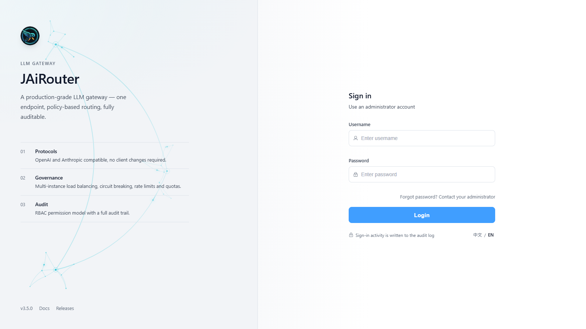
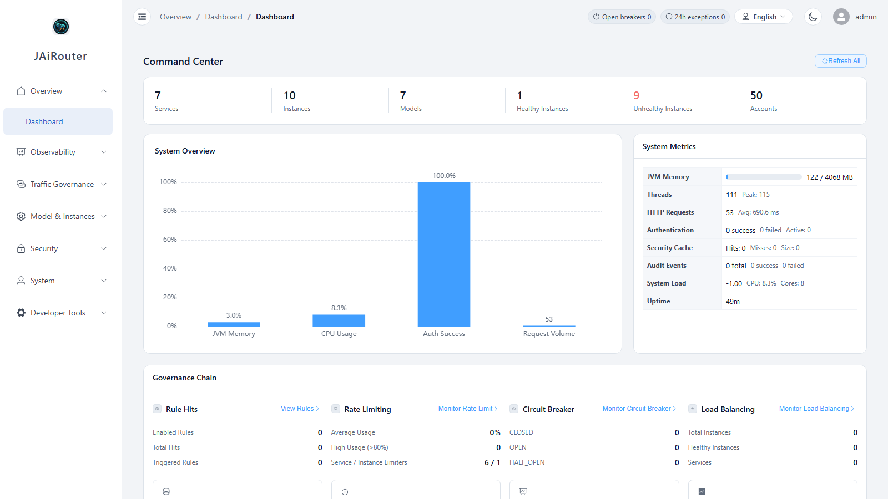
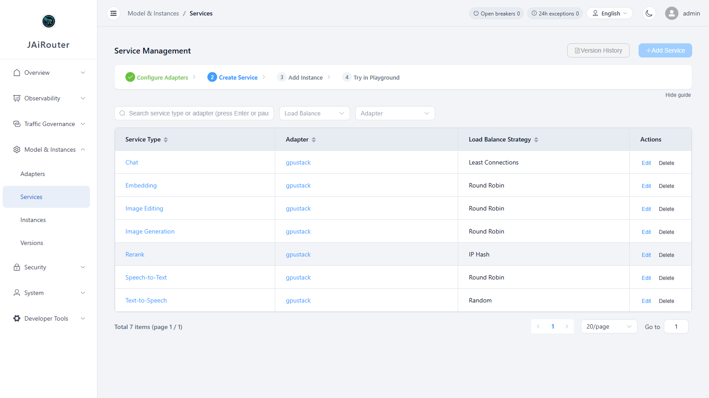
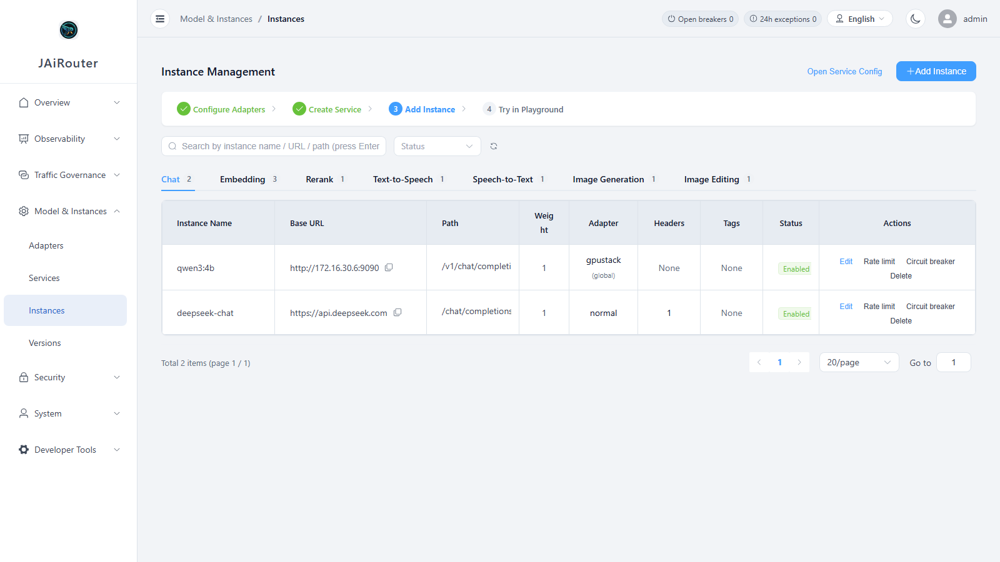
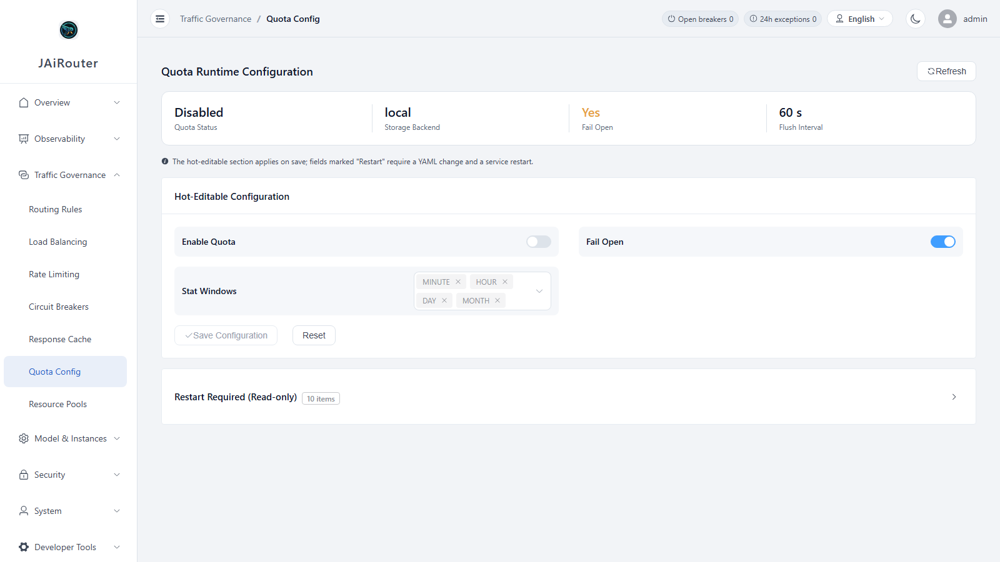

# Web Console Operation Guide

<!-- Version Info -->
> **Doc Version**: 1.1.0
> **Last Updated**: 2026-11-27
> **Applicable Version**: v3.9.0
> **Author**: Lincoln
<!-- /Version Info -->

This guide is for first-time users of the JAiRouter Web Console, covering everything from login to connecting your first model service, quota management, observability, and access control.

## 1. Login and First Launch

### 1.1 Access URL

| Deployment | URL | Notes |
|------------|-----|-------|
| Local dev (Vite) | `http://localhost:3000/admin` | Vite dev server, hot reload |
| Production / standalone | `http://<host>:8080/admin` | Backend-served SPA |

Both entry points serve the same frontend code with identical functionality.

### 1.2 Default Accounts

| Username | Default Password | Role | Description |
|----------|-----------------|------|-------------|
| `admin` | `ChangeMeOnFirstStartup123456` | ADMIN, USER | Super admin with all 79 permission codes |
| `user` | `user123456` | USER | Regular user, primarily read-only |

> ⚠️ **Change the `admin` password before first production use.** The password is set via the `INITIAL_ADMIN_PASSWORD` environment variable (see `src/main/resources/config/auth/jwt.yml`). Restart the service after changing it.

```bash
# Example: set the environment variable before startup
export INITIAL_ADMIN_PASSWORD="YourStr0ngPassword#2026"
```

### 1.3 Token Storage

After a successful login, the JWT is stored in the browser `localStorage` under the key `admin_token`.

> ⚠️ **Do not inject tokens manually.** The frontend route guard (`router.beforeEach`) performs the following checks on every navigation:
>
> 1. Checks whether `admin_token` exists in `localStorage`;
> 2. Decodes the JWT to verify expiration (marked expired 60 seconds early);
> 3. Validates that the route's `meta.roles` / `meta.permissions` requirements are met.
>
> Only when all conditions pass is navigation allowed; otherwise the user is redirected to `/login`. A manually written token that is expired or missing the `permissions` claim will prevent the console from functioning properly.

### 1.4 Login Flow

1. Open the console URL in a browser;
2. The page title displays **JAiRouter Admin** (zh: **JAiRouter 管理后台**);
3. Enter your username and password, then click the **Login** button;
4. On success, you are automatically redirected to the **Dashboard** page.



---

## 2. Interface Layout

### 2.1 Left Navigation

The console has a collapsible sidebar containing **8 menu groups** with **39 menu items** and **53 pages (tabs)**, at most 8 items per group. Pages that belong together are folded into **tabs** (for example, "Call History" holds "Call Records / Call History Dashboard"); tabs are ordered and switch in place.

Menu visibility is controlled by permission codes: groups/menu items for which the user lacks the required code are hidden, and **each tab is gated separately** — if the user can only see some tabs, the item still shows and the landing tab is the first one the user is allowed to open.



| # | Group (en) | Group (zh) | Menu items (tabs in parentheses, `｜` separated) |
|---|-----------|-----------|------------------------------------------|
| 1 | Overview | 概览 | Dashboard |
| 2 | Observability | 运行观测 | Call History (Call Records ｜ Call History Dashboard), Distributed Tracing (Trace Search ｜ Tracing Dashboard), Exceptions (Exception List ｜ Statistics), Slow Requests (Slow Calls ｜ Slow SQL), Usage (Token Usage ｜ Quota Usage), Audit Logs |
| 3 | Traffic Governance | 流量治理 | Routing Rules, Load Balancing (Real-time Monitoring ｜ Strategy Config), Rate Limiting (Rate Limit Monitoring ｜ Rate Limit Config), Circuit Breakers (Circuit Monitoring ｜ Circuit History ｜ Global Config), Resource Pools |
| 4 | Model & Instances | 模型与实例 | Adapters, Service Management, Instance Management, Version Management |
| 5 | Security | 安全 | API Key Management, JWT Token Management, Blacklist Management, PII Sanitization, Record Governance, Login Protection |
| 6 | Access & Identity | 访问与身份 | Account Management, Permission Management, SLA Access |
| 7 | Platform Settings | 平台设置 | **Runtime Configuration**: Monitoring Config (Monitoring Config ｜ Runtime & Emergency), Tracing Config, Response Cache Management, Quota Runtime Config; **Deployment & Infrastructure**: State Persistence, Cluster Settings, Health Probe Settings; **Audit**: Operation Records |
| 8 | Developer Tools | 开发工具 | AI Playground (Chat ｜ Embeddings ｜ Rerank ｜ Audio ｜ Images), Client Access Guide |

> This information architecture (IA) change folds 9 groups / 40 entries into 7 groups / 28 items; later additions and a regrouping brought it to 8 groups / 39 items and 53 pages (v3.5.1 Record Governance, v3.8.6 Cluster Settings, v3.8.7 Health Probe Settings, v3.8.8 Operation Records and Monitoring Config, SLA Access): 12 entries became tabs of a sibling item, and **every URL stays the same**. Deep links, bookmarks, and the paths in the appendix keep working; they simply no longer occupy a sidebar row of their own.

### 2.2 Top Bar

| Area | Element | Description |
|------|---------|-------------|
| Left | Breadcrumb | Format: Group / Menu item / Current tab (duplicates collapsed) |
| Right | Language Switcher | Capsule button with dropdown to select 中文 or English; change takes effect immediately |
| Right | Theme Toggle | Round button with ☀️/🌙 icon to switch between light and dark themes |
| Right | User Menu | Avatar + username (e.g. `admin`); dropdown contains **Profile** and **Log Out** |

### 2.3 Breadcrumb

The top of the page displays the current navigation path, e.g. `Overview / Dashboard` or `Observability / Call History / Call Records`. The last segment is the current page and is not clickable; the preceding segments are. Detail pages (e.g. `/exceptions/detail/:id`) append `#<id>` to the last segment. The breadcrumb updates automatically when navigating between pages.

---

## 3. Minimum Path to Connect Your First Model Service

The following steps are ordered by dependency, using an Ollama model service as an example.



### Step 1: Configure a Service

**Menu path**: Model & Instances → Service Management

1. Go to the **Service Management** page;
2. Click the **Add Service** button;
3. Fill in the form:

| Field | Description | Required |
|-------|-------------|:--------:|
| Service Type | Dropdown selection, e.g. `chat`, `embedding`, `completion` | ✅ |
| Adapter | Dropdown to select the adapter type | ✅ |
| Load Balance Strategy | Eight kinds: round robin / weighted / least connections / IP hash / consistent hash / latency-aware (EWMA) / random / sticky session | ✅ |
| Description | Optional note | ❌ |

4. Click **Save**;
5. After saving, the service type appears in the list with status **Enabled**.

### Step 2: Configure an Instance

**Menu path**: Model & Instances → Instance Management



1. Go to the **Instance Management** page;
2. Select the corresponding service type from the left dropdown;
3. Click the **Add Instance** button;
4. Fill in the form:

| Field | Description | Required | Example |
|-------|-------------|:--------:|---------|
| Service Type | The associated service type | ✅ | `chat` |
| Instance Name | Instance identifier | ✅ | `ollama-local` |
| Base URL | Downstream service address | ✅ | `http://localhost:11434` |
| Path | Request path (optional) | ❌ | `/v1/chat/completions` |
| Weight | Load balancing weight | ✅ | `1` |
| Adapter | Leave empty to use global config | ❌ | — |

5. Expand the **Request Header Config** section and add headers required by the downstream service:

| Header Name | Header Value | Description |
|-------------|-------------|-------------|
| `Authorization` | `Bearer <your-api-key>` | Authentication credential transparently forwarded to the downstream model service |

> 💡 The `Authorization` header is **forwarded transparently to the downstream service** — it is not the gateway's own credential. The gateway credential is `X-Jairouter-Token` (JWT).

6. Optional: expand the **Tag Config** section and add tags for routing rule matching;
7. Click **Save**;
8. After saving, the instance appears in the list. The status column shows the health status (healthy/unhealthy).

### Step 3: Version and Adapter (If Needed)

- **Version Management** (Model & Instances → Version Management): Configure version information if needed. This is not a required step.
- **Adapters** (Model & Instances → Adapters): View and manage registered adapters. Skip this step if the adapter was correctly selected in Step 1.

### Step 4: Verify Connectivity

After configuration, verify using these methods:

1. **Dashboard** (Overview → Dashboard): Check the "Service Configuration Overview" area to confirm service instance count and healthy instance count;
2. **Instance Management** page: The instance status column should show a green **Healthy** label (not **Unhealthy**);
3. **Load Balancer Monitoring** (Traffic Governance → Load Balancer Monitoring): View real-time load balancing status.

### Step 5: Test in Playground

**Menu path**: Developer Tools → AI Playground → Chat Playground

1. Go to the **Chat Playground** page;
2. Select the model matching the service type configured in Step 1;
3. Enter a message and send it;
4. If you receive a response, the entire pipeline (Console → Gateway → Model Service) is working.

> 💡 Playground requires the `ai:playground:use` permission code. Both ADMIN and USER roles have this permission by default.

---

## 4. How Quotas Work

### 4.1 Quota Runtime Configuration

**Menu path**: Platform Settings → Runtime Configuration → Quota Runtime Config

The quota feature is **disabled by default**. To enable it:



1. Go to the **Quota Runtime Configuration** page;
2. Find the **Hot-Editable Configuration** section;
3. Turn on the **Enable Quota** switch;
4. Optional settings:
   - **Fail Open**: whether to allow requests when the quota system is unavailable;
   - **Stat Windows**: select the statistical window dimensions;
5. Click **Save Configuration**.

**Hot-editable fields** (take effect immediately, no restart):

| Field | Description |
|-------|-------------|
| `enabled` | Enable/disable quotas |
| `failOpen` | Fail-open switch |
| `windows` | Statistical window selection |

**Restart-required fields** (marked with a **Restart** badge, read-only):

| Field | Description |
|-------|-------------|
| `backendName` | Storage backend name |
| `distributedEnabled` | Distributed enabled |
| `distributedKeyPrefix` | Distributed key prefix |
| `distributedTimeout` | Distributed timeout |
| `flushIntervalSeconds` | Flush interval |

### 4.2 Quota Usage Monitoring

**Menu path**: Observability → Usage → Quota Usage

On the **Quota Usage Monitoring** page you can:

- View quota **runtime status**: storage backend type, degradation status;
- Filter usage data by **Tenant ID / API Key ID / User ID / Service Type / Model / Window**;
- View **usage details**: request count, token count.

> 💡 If the page displays **"Quota ledger not enabled, usage data unavailable"**, the quota feature is not enabled. Go to the Quota Runtime Config page first to enable it.

---

## 5. Observability and Troubleshooting

### 5.1 Call History and Exceptions (Observability)

| Page | Path | What It Answers |
|------|------|-----------------|
| Call History Dashboard | `/call-history/dashboard` | Overall call volume trend, success/failure rate overview |
| Call List | `/call-history/list` | Detailed record of every request (time, service, status code, latency) |
| Token Usage | `/call-history/token-usage` | Token consumption per model/service |
| Slow Calls | `/call-history/slow-calls` | Which requests took too long |
| Slow SQL | `/monitoring/slow-queries` | Deep analysis of slow requests (requires `monitoring:slowquery:read`) |
| Quota Usage Monitoring | `/monitoring/quota` | Quota consumption details |
| Exception List | `/exceptions/list` | List of all exception events (requires `monitoring:exceptions:read`) |
| Statistics | `/exceptions/statistics` | Exception distribution by type/time |

### 5.2 Distributed Tracing (Observability)

| Page | Path | What It Answers |
|------|------|-----------------|
| Tracing Dashboard | `/tracing/dashboard` | Trace volume trends, latency distribution, error rate trends, throughput |
| Tracing Search | `/tracing/search` | Locate specific request traces by Trace ID / service name / time range |
| Tracing Config | `/tracing/management` | Tracing toggle, sampling rate, exporter configuration (Logging / OTLP / Jaeger); moved to the **Platform Settings** group |

### 5.3 Dashboard Overview

Overview → Dashboard provides a single-pane view:

- **System Overview**: service count, instance count, healthy instances, unhealthy instances;
- **System Metrics**: JVM memory, thread count, HTTP requests, CPU usage, uptime;
- **Governance Chain**: shortcuts to rule hits, rate limiting, circuit breaker, load balancing status;
- **Exception / Alert Summary**: recent exception event list;
- **Service Configuration Overview**: global config summary (adapter, rate limit, circuit breaker, etc.).

---

## 6. Permissions and Roles

### 6.1 Seven Built-in Roles

| Role | Permission Count | Permission Scope | Description |
|------|:----------------:|------------------|-------------|
| **ADMIN** | 79 | All permission codes | Super admin; bypasses URL rules, full codes embedded in JWT |
| **OPERATOR** | 55 | All `:read` + `:write` codes | Day-to-day ops; excludes system management (`system:*`), security management `manage` codes (API Key / JWT Token / Blacklist management); holds `callhistory:read` (records and summaries, no bodies) |
| **USER** | 9 | Own call records, own exceptions, own token usage, slow requests, trace search, lb/cb/rl monitoring, AI Playground | Regular user; all read codes, no write code and no global observability codes (`monitoring:tokenusage:read` and `monitoring:exceptions:read` are revoked from the existing database) |
| **VIEWER** | 31 | All `:read` codes (minus the 10 codes paired with write/manage surfaces and `callhistory:read`) | Pure read-only role; no call history (`callhistory:read`), `ai:playground:use`, or other non-`:read` codes |
| **AUDITOR** | 3 | Dashboard, security audit events, admin operation records | Minimal set for third-party auditors; strictly read-only, deliberately excludes call record bodies (business data), every `config:*:read` code, and any write code |
| **SLA_READONLY** | 35 | Read-only inspection surface | Read-only role for SLA tooling: dashboard, config read codes, lb/cb/rl monitoring, `callhistory:read` (summaries only), monitoring read, tracing read, audit log read; no record bodies and no management codes |
| **SLA_OPERATOR** | 53 | Read-only inspection plus configuration writes | Adds the 15 `config:*:write` codes, `lb:config:write`, `tracing:config:manage` and `monitoring:config:write` on top of SLA_READONLY; still no account/permission management and no `security:*:manage` |

### 6.2 Why Some Menu Pages Are Missing {#why-menu-pages-missing}

Frontend menu rendering is filtered by permission codes:

1. Each menu group/item is associated with a permission code (e.g. `config:services:read`);
2. After login, the JWT's `permissions` claim contains the current user's permission code list;
3. The `usePermission` composable filters out menu items the user does not have;
4. The route guard (`meta.permissions`) further blocks direct URL access without permissions.

**Resolution**:

1. Go to **Access & Identity → Permission Management** (requires `system:permissions:manage`, ADMIN only);
2. Find the target role, check the missing permission codes, and save.

> 💡 `/v1/**` (OpenAI-compatible inference endpoints) is independent of the RBAC system and only requires authentication — it is not restricted by permission codes.

---

## 7. Multi-Protocol Access

### 7.1 Client Access Guide

**Menu path**: Developer Tools → Client Access Guide

This page provides complete access examples for the OpenAI-compatible API and the Anthropic-compatible API, including Base URL, authentication method, curl examples, and SDK examples.

### 7.2 Credential Header Specifications

| Protocol Surface | Credential Header | Description |
|-----------------|-------------------|-------------|
| OpenAI-compatible | `X-API-Key: <Gateway API Key>` | Used for `/v1/*` endpoints |
| Anthropic-compatible | `x-api-key: <Gateway API Key>` | Used for the Anthropic Messages API |
| Console | `X-Jairouter-Token: <JWT>` | Management API credential after Web Console login |
| `Authorization` | — | **Forwarded transparently to the downstream model service**; not a gateway credential |

> ⚠️ The `Authorization` header (e.g. `Bearer <token>`) is forwarded as-is to the downstream model service by the gateway — it is not used as the gateway's own authentication credential.

---

## 8. Common Issues

### 8.1 401 After Login

**Symptom**: API requests return 401 Unauthorized after logging in.

**Possible causes**:

1. The JWT has expired (default validity is 60 minutes);
2. The `JWT_SECRET` environment variable is inconsistent across restarts, causing token signature verification to fail.

**Resolution**:

- Log in again to obtain a new token;
- Verify that the `JWT_SECRET` environment variable has not changed after a restart.

### 8.2 403 After Login

**Symptom**: Some APIs return 403 Forbidden.

**Possible cause**: The current user's role lacks the required permission code.

**Resolution**:

- Log in with the `admin` account, go to Access & Identity → Permission Management, and add the missing permission code to the role;
- See the [RBAC Permission Management](../security/rbac-permissions.md) documentation for details on the permission code system.

### 8.3 Missing Menu Pages

**Symptom**: After logging in, some menu groups or pages are missing from the sidebar.

**Possible cause**: The current user's role does not include the permission code for the corresponding menu item.

**Resolution**:

- See [6.2 Why Some Menu Pages Are Missing](#why-menu-pages-missing).

### 8.4 OpenAI SDK Integration Error

**Symptom**: Using the OpenAI SDK returns 401.

**Possible cause**: The SDK defaults to using the `X-Jairouter-Token: <key>` header rather than `X-API-Key`. The gateway's OpenAI-compatible endpoint requires the `X-API-Key` header for API Key authentication.

**Resolution**:

- Use the `X-API-Key` header instead of `Authorization` to pass the API Key;
- See the SDK example on the Developer Tools → Client Access Guide page.

### 8.5 Redis Unavailable Degradation

**Symptom**: The dashboard or monitoring pages show connection errors.

**Possible cause**: When JAiRouter uses Redis for JWT persistence or distributed quota storage, Redis is not started or is unreachable. In local development, Redis is disabled by default (`redis.enabled: false`), and JWT uses H2 + memory fallback.

**Resolution**:

- Local development: No Redis needed — JWT uses H2 storage with memory fallback, and functionality is unaffected;
- Production: Ensure Redis is available, or configure `jairouter.security.jwt.persistence.fallback-storage: memory`.

### 8.6 Quotas Not Taking Effect

**Symptom**: After sending requests, the Quota Usage Monitoring page shows no data.

**Possible cause**: The quota feature is disabled by default.

**Resolution**:

1. Go to Platform Settings → Runtime Configuration → Quota Runtime Config;
2. Enable the quota switch and save;
3. Verify the storage backend status is normal (not degraded).

---

---

## 9. Page Tour and How to Read It

The README keeps four groups of screenshots (command center, services and instances, observation and records, playground and access). This section carries the page-by-page notes: what each page answers, and which numbers are easy to misread.

### 9.1 Service Management: the triple and the four-step guide

A service is a triple of (service type, adapter, load balancing strategy). The gateway serves seven types — chat, embeddings, rerank, speech-to-text, text-to-speech, image generation, image editing — each bound to an adapter (GPUStack, vLLM, Ollama, OpenAI, …) and one of eight balancing strategies (see the field table in step 1 of section 3).

The four-step guide at the top of the page is the recommended order for onboarding a backend: configure the adapter, create the service, add instances, then try it in the playground. A wrong adapter surfaces in step one instead of on the first real request.

### 9.2 Instance Management: real endpoints and per-instance control

An instance is a real endpoint: base URL, path, weight, per-instance headers and tags, grouped into tabs by service type. The weight feeds the weighted strategies, the tags feed rule conditions, and per-instance headers are how you keep a downstream credential on exactly one upstream.

Each row carries its own rate limiter and circuit breaker, so a misbehaving upstream can be isolated and repaired on its own instead of taking the whole service down with it.

### 9.3 Routing Rules: before balancing, disable instead of delete

Rules are evaluated before any load balancing decision, ordered by priority, and drag and drop changes that order. A rule can be disabled instead of deleted, and its hit count updates live — so a rule that never fires is visible, not silently dead. Tenant pinning, staged rollout, and header-based A/B all ship as templates.

### 9.4 Call History Dashboard: three record levels folded into one board

Every call is recorded at one of three levels (metadata only, sanitized summary, or AES-256-GCM encrypted full text; switch it under Security → Record Governance). The dashboard folds the records into the numbers operations actually needs: total and failed requests, success rate, average response time, token spend and per-request average, then daily trend, top 10 models, service type mix, and a 24-hour distribution. The time range at the top filters every panel at once, and the raw records sit in the next tab.

### 9.5 Slow Queries: what "fired" and "suppressed" mean

Slow queries are counted, grouped by operation type, and reported per group with count, average, max, min and total time, plus a hotspot table pointing at the worst offenders. The two numbers on the right are easy to misread: alerts **fired** and alerts **suppressed**. Suppression is the cooldown — one hotspot that keeps crossing the threshold is recorded once and then goes quiet, so more suppressions than firings means the cooldown is working, not that the threshold is broken.

### 9.6 Quota Runtime Configuration: hot-reload vs restart-required

Quota settings are split by what it costs to apply them: the ones that hot-reload (enable quota, fail-open, statistics window) take effect on save, while restart-required fields are read-only and marked as such, instead of letting you edit them and discover later that nothing changed. The status bar at the top spells out the effective state — enabled or not, storage backend (local or Redis), fail-open, flush interval. Quantity is off by default, and this is where you turn it on.

### 9.7 Quota Usage Monitoring: six dimensions and four status cards

Usage can be filtered on six dimensions at once — tenant, API key, user, service type, model, statistics window — so per-tenant reconciliation or a post-incident review of one key needs no export first.

The four status cards answer the questions that actually come up during an incident (is the ledger enabled, which backend, is it degraded, how many active windows) before showing any figures; with no data the page says why (quota ledger not enabled) instead of rendering an empty table and leaving you to guess.

### 9.8 Client Access Guide

The first page for an outside team: base URL, the `X-API-Key` header, `GET /v1/models`, `POST /v1/chat/completions` and its streaming form, then the same call as `curl` and as the OpenAI Python SDK, each block copyable. The base URL comes from this gateway's own configuration, so what you copy is the address it actually serves.

### 9.9 Playground

One model selector, five benches behind it: chat, embeddings, rerank, audio and images. Credentials, routing and record governance match a real client, but the request and the streamed response are rendered on the page — the fastest way to check whether a newly added instance answers correctly. Sending is disabled until a model is selected, so there is no "clicked it, nothing happened".

### 9.10 Theme and Language

One toggle in the top bar switches to dark without a separate build and without a query parameter; the zh-CN / en-US switch sits beside it. Both affect the console display only and change no interface behaviour.


---

## Appendix: Page Path Quick Reference

| Group | Menu Item | Tabs and Route Paths (order = tab order) |
|-------|-----------|-----------------------------------------|
| Overview | Dashboard | `/dashboard/main` |
| Observability | Call History | Call Records `/call-history/list` ｜ Call History Dashboard `/call-history/dashboard` |
| Observability | Distributed Tracing | Trace Search `/tracing/search` ｜ Tracing Dashboard `/tracing/dashboard` |
| Observability | Exceptions | Exception List `/exceptions/list` ｜ Statistics `/exceptions/statistics` (detail `/exceptions/detail/:id` is a deep link, not a sidebar entry) |
| Observability | Slow Requests | Slow Calls `/call-history/slow-calls` ｜ Slow SQL `/monitoring/slow-queries` |
| Observability | Usage | Token Usage `/call-history/token-usage` ｜ Quota Usage `/monitoring/quota` |
| Traffic Governance | Routing Rules | `/config/rules` |
| Traffic Governance | Load Balancing | Real-time Monitoring `/load-balancers/monitoring` ｜ Strategy Config `/load-balancers/strategy-config` |
| Traffic Governance | Rate Limiting | Rate Limit Monitoring `/rate-limiters/monitoring` |
| Traffic Governance | Circuit Breakers | Circuit Monitoring `/circuit-breakers/monitoring` ｜ Circuit History `/circuit-breakers/history` ｜ Global Config `/circuit-breakers/global-config` |
| Platform Settings | Response Cache Management | `/config/cache` |
| Traffic Governance | Quota Runtime Config | `/config/quota` |
| Traffic Governance | Resource Pools | `/config/pools` |
| Model & Instances | Adapters | `/config/adapters` |
| Model & Instances | Service Management | `/config/services` |
| Model & Instances | Instance Management | `/config/instances` |
| Model & Instances | Version Management | `/config/versions` |
| Security | API Key Management | `/security/api-keys` |
| Security | PII Sanitization | `/security/sanitization` |
| Security | JWT Token Management | `/security/jwt-tokens` |
| Security | Blacklist Management | `/security/blacklist` |
| Security | Audit Logs | `/security/audit-logs` |
| Security | Record Governance | `/security/record-governance` |
| Security | Login Protection | `/security/login-guard` |
| Platform Settings | Account Management | `/system/accounts` |
| Platform Settings | Permission Management | `/system/permissions` |
| Platform Settings | Tracing Config | `/tracing/management` |
| Platform Settings | Monitoring Config | Monitoring Config `/monitoring/config` ｜ Runtime & Emergency `/monitoring/config/runtime` |
| Platform Settings | State Persistence | `/config/state-persistence` |
| Platform Settings | Cluster Settings | `/system/cluster` |
| Platform Settings | Health Probe Settings | `/system/health` |
| Platform Settings | Operation Records | `/system/console-operations` |
| Developer Tools | AI Playground | Chat Playground `/playground/chat` ｜ Embedding `/playground/embedding` ｜ Rerank `/playground/rerank` ｜ Audio Service `/playground/audio` ｜ Image Service `/playground/image` |
| Developer Tools | Client Access Guide | `/tools/client-access` |

### PII Sanitization (v3.2.0)

Path: **Security → PII Sanitization** `/security/sanitization` (permission `security:sanitization:manage`)

1. Review the response-side sub-config (PII patterns, sensitive words, masking char, scope)
2. Save to hot-rebuild the rule set (record-path SUMMARY applies immediately)
3. Dry-run with a chat sample; expect `****` in the result
4. Gateway live responses are not masked by default; admin `/api/**` and AI paths are excluded

### Record Governance (v3.5.1)

Path: **Security → Record Governance** `/security/record-governance` (permissions `config:callhistory:read` / `config:callhistory:write`)

1. Pick one of three record levels: `METADATA_ONLY` / `SUMMARY` / `FULL` (full content, encrypted at rest); switching to `FULL` asks for confirmation
2. The read-only "Encryption and storage" card shows both the **configured** key source and the **effective** key source, plus the key fingerprint, per-record content limit (64 KB by default), retention and max records
3. If the configuration requests `env` but `JAIR_CALL_HISTORY_KEY` is unavailable, a fallback warning appears and "effective" reads `auto` — content is then encrypted with the key file at `~/.jairouter/call-history.key`
4. Save submits `recordLevel` only; every other field is driven by `jairouter.call-history.*` and is read-only here
5. At the `FULL` level, viewing a record detail decrypts it on the server and writes a `FULL_CONTENT_ACCESS` audit event (queryable on the Audit Logs page)

### API Key Quota Ops (v3.2.0)
Path: **Security → API Key Management** → row action **Quota**

1. Open the quota drawer: today usage / remaining + presets
2. Adjust limits → **Save Quota** (quota fields only)
3. **Reset Counters** clears daily usage/rate
4. Quota Monitoring cross-links back to API Keys for limit edits

### Quota Usage Monitoring

Path: **Observability → Usage → Quota Usage** `/monitoring/quota`

- Shows multi-dimensional usage plus daily request/token limits and progress
- **Set limits on API Keys** navigates to `/security/api-keys`
